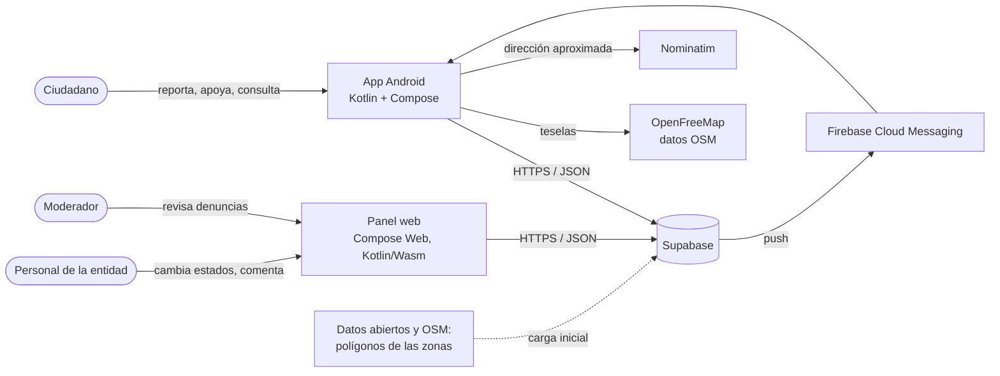
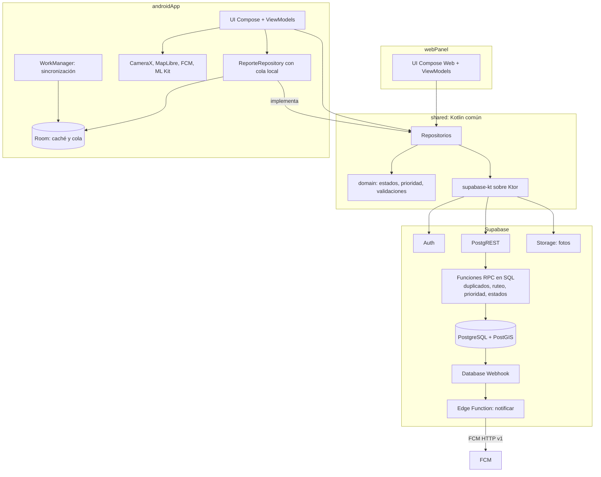
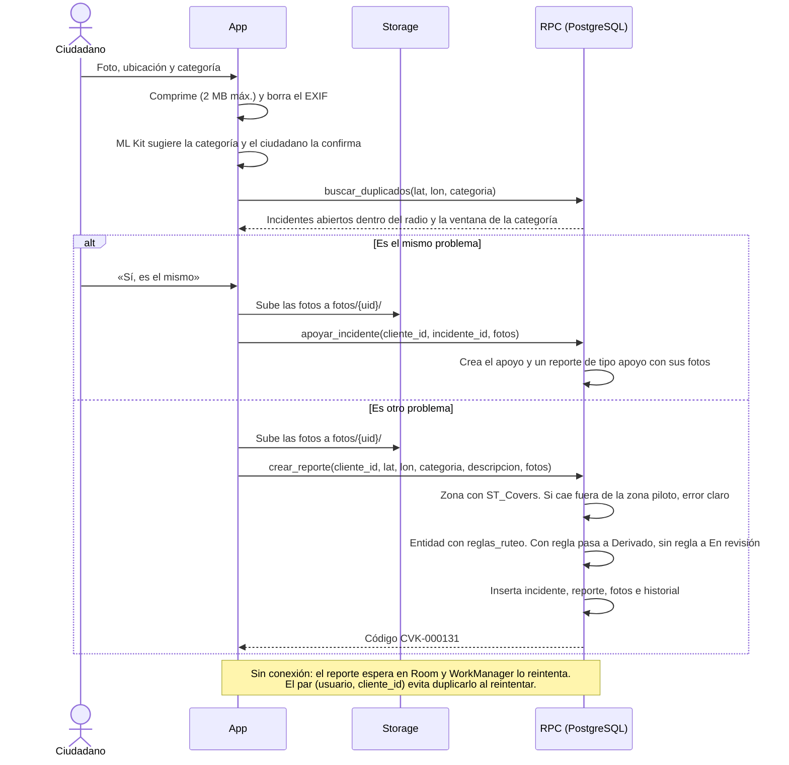
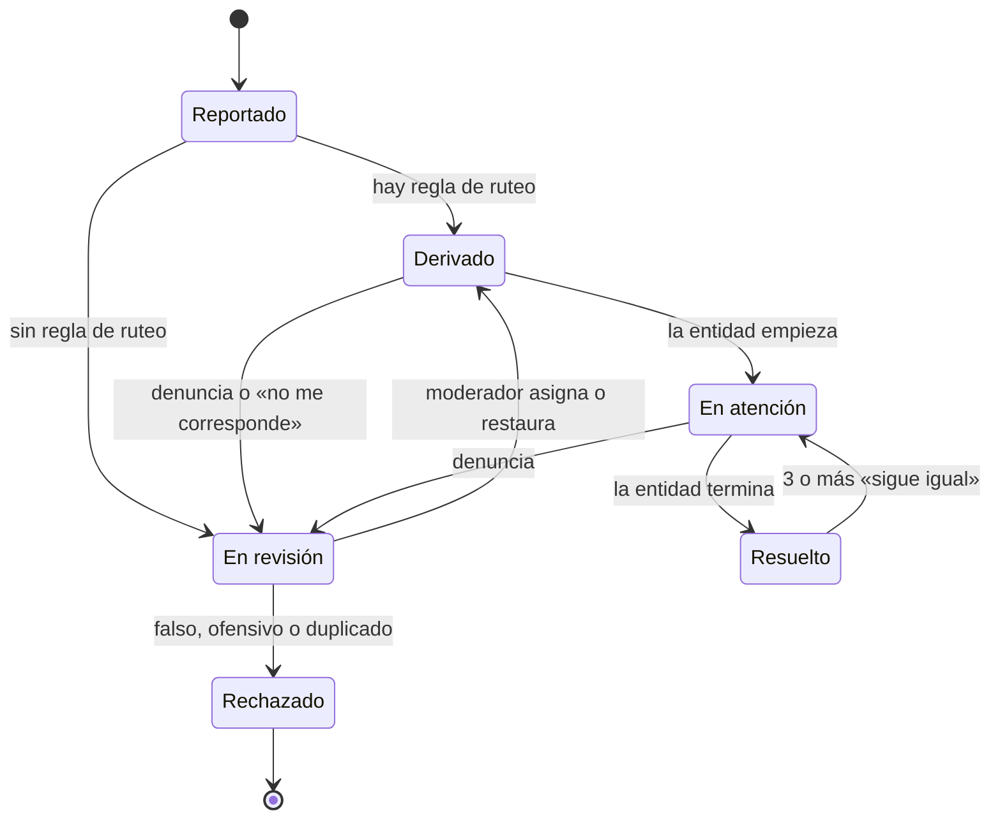
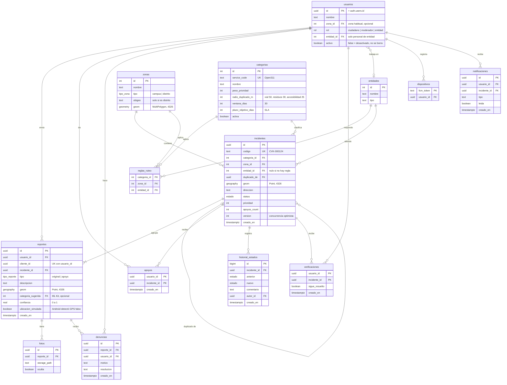
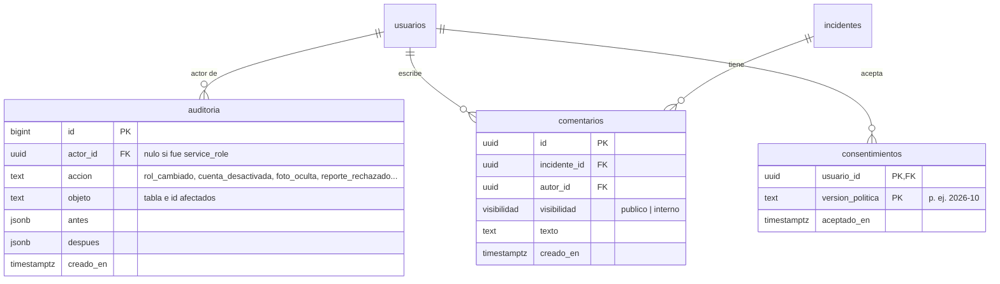
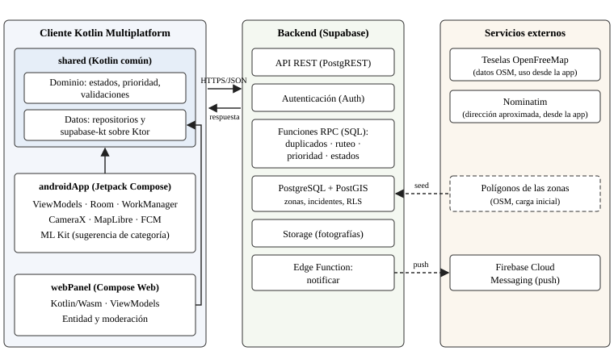
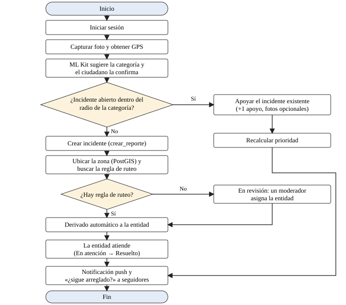

# Arquitectura de Cívika (MVP)

Este documento es la referencia técnica del equipo. Desarrolla el diseño de la sección 3.1.2 de los
[entregables](entregables-1-y-2.md#312-diseño-del-sistema): cómo encajan las piezas, qué datos hay, qué estados puede
tener un incidente, quién puede hacer qué y por qué se decidió cada cosa. Cuando una decisión cambie, se actualiza aquí
**antes** de cambiar el código.

> **Diagramas con íconos:** en [diagramas/](diagramas/README.md) están la arquitectura del sistema, el flujo de CI/CD,
> la arquitectura hexagonal, las clases del dominio y el flujo de un reporte por actor. Se editan con draw.io.

## 1. Vocabulario del dominio

| Término | Qué es |
|---|---|
| **Reporte** | Lo que envía **un** ciudadano: fotos, ubicación, categoría y descripción. Un apoyo con foto también genera un reporte, de tipo `apoyo` |
| **Incidente** | El problema real en la calle. Agrupa uno o varios reportes del mismo problema |
| **Apoyo** | Un ciudadano dice «yo también lo vi». Hay uno como máximo por usuario e incidente |
| **Seguidores** | Los autores de los reportes de un incidente y los usuarios que lo apoyaron. Son quienes reciben las notificaciones (RF-11) |
| **Entidad** | Organización responsable de atender: municipalidad, empresa prestadora, etc. |
| **Zona** | Área con polígono donde funciona Cívika: el campus de la UNMSM o un distrito. Reemplaza a «distrito» porque el piloto no es un distrito completo |
| **Regla de ruteo** | La regla (categoría + zona) → entidad que decide a quién le toca un incidente |
| **Plazo objetivo** | Días en que debería resolverse un incidente según su categoría (SLA). Sirve para la prioridad y los indicadores |
| **Denuncia** | Aviso de un ciudadano de que un reporte es falso, ofensivo o repetido (RF-16) |
| **Verificación** | La respuesta de un seguidor a «¿sigue arreglado?» después de que un incidente se marca como resuelto |

La diferencia entre **reporte** e **incidente** es la base de la detección de duplicados. Si 30 vecinos ven el
mismo bache, hay 1 incidente con 30 apoyos (o con varios reportes), no 30 incidentes.

## 2. Contexto



## 3. Contenedores

Todo el cliente es **Kotlin Multiplatform**: un módulo `shared` con el dominio y el acceso a datos, que usan la app
Android y el panel web.



## 4. Flujo principal: crear un reporte



**Distancias en metros:** los puntos se guardan como `geography(Point, 4326)`. Con `geometry` en 4326,
`ST_DWithin(a, b, 50)` mediría 50 **grados**, no metros. Con `geography`, el 50 sí son metros y el índice GiST
funciona igual.

**Idempotencia de la sincronización:** cada reporte lleva un `cliente_id` (UUID) que se genera en el celular. La
restricción única es (`usuario_id`, `cliente_id`), así que un usuario no puede chocar con el UUID de otro. La RPC hace
`INSERT … ON CONFLICT (usuario_id, cliente_id) DO NOTHING` y, si no insertó nada, devuelve el reporte que ya existía.
Al no haber un «comprueba y después inserta», tampoco hay condición de carrera entre dos reintentos simultáneos. Si
WorkManager reintenta tres veces, se crea **un solo** reporte.

**Validaciones de la RPC:** cada ruta de foto debe empezar por `{auth.uid()}/`, existir en el bucket y pertenecer al
usuario autenticado (`owner_id`/`owner`); las rutas internas no se exponen a la entidad. Además, la categoría debe
estar activa y el usuario no debe superar el límite anti-spam (sección 11).

## 5. Estados del incidente



La entidad se asigna **automáticamente** al crear el incidente (RF-06). La moderación no frena el flujo normal:
solo interviene cuando no hay regla de ruteo, cuando alguien denuncia un reporte (RF-16, en cualquier estado no
final) o cuando la entidad dice que no le corresponde.

| Transición | Quién la hace | Efecto |
|---|---|---|
| Reportado → Derivado | Sistema, dentro de `crear_reporte` | Notifica al autor |
| Reportado → En revisión | Sistema (no hay regla de ruteo) | Aparece en la cola de moderación |
| Derivado o En atención → En revisión | Sistema (al recibir una denuncia) o la entidad | Aparece en la cola de moderación |
| En revisión → Derivado | Moderador | Notifica a los seguidores |
| En revisión → Rechazado | Moderador | Notifica al autor con el motivo. Si es duplicado, se llena `duplicado_de` y sus reportes pasan al incidente original |
| Derivado → En atención | Personal de la entidad asignada | Notifica a los seguidores |
| En atención → Resuelto | Personal de la entidad asignada | Pregunta «¿sigue arreglado?» a los seguidores |
| Resuelto → En atención | Sistema (3 o más verificaciones «sigue igual») | Notifica a la entidad |

Cada transición se guarda en `historial_estados`, con su fecha. Solo se puede cambiar de estado con la RPC
`cambiar_estado`, que valida esta tabla. Nadie actualiza la columna `status` directamente.

## 6. Modelo de datos



Restricciones que no se ven en el diagrama:
- `reportes` es única por (`usuario_id`, `cliente_id`) y `reglas_ruteo` por (`categoria_id`, `zona_id`).
- Hay índices GiST sobre `incidentes.geom`, `reportes.geom` y `zonas.geom`.
- **Zonas del piloto (seed):** «Ciudad Universitaria UNMSM» (`campus`) y «Alrededores de la Ciudad Universitaria»
  (`distrito`), con polígonos dibujados sobre OSM. Las zonas no se superponen. Para escalar a otro distrito basta
  con insertar su zona y sus reglas (RNF-08).
- `apoyos_count` lo mantiene un trigger. La app nunca lo escribe.
- El Entregable 2 nombraba una tabla `notificaciones`. Se mantiene como la bandeja de cada usuario (la pantalla de
  notificaciones), y los tokens de FCM se separan en `dispositivos`.
- Al marcar un incidente como resuelto se borran sus `verificaciones` anteriores, para que cada resolución se vote de cero.
- **Concurrencia:** `cambiar_estado(incidente_id, nuevo_estado, version_esperada)` solo aplica el cambio si
  `incidentes.version` coincide. Si dos personas de la entidad cambian el mismo incidente a la vez, la segunda recibe
  «el incidente cambió, recarga» en lugar de pisar el cambio de la primera. La `version` la incrementa un trigger en
  **cada** cambio de `status`, también en los del Sistema (ruteo y reapertura).
- **Ubicación simulada:** si Android detecta GPS falso (`Location.isMock` en API 31+, `isFromMockProvider` antes), el
  reporte se acepta, pero se marca `ubicacion_simulada = true` y va a En revisión en vez de derivarse solo. Es una
  mitigación **parcial**: un teléfono con root puede ocultar la simulación.

**Tablas de soporte** (permisos, trazabilidad y privacidad):



- `auditoria` es **solo de inserción**: ninguna política permite `update` ni `delete`, y la llenan triggers sobre
  `usuarios` (rol, entidad, activo), `fotos` (oculta) y las transiciones a Rechazado. Solo el moderador la lee.
- `comentarios` reemplaza el texto libre de `historial_estados.comentario`. Los `publico` los ve el ciudadano; los
  `interno` solo la entidad y la moderación.
- `consentimientos` guarda qué versión de la política aceptó cada usuario. Si la política cambia, la app vuelve a
  pedir la aceptación.

**Prioridad (versión inicial, RF-09):** `prioridad = peso_prioridad × 10 + min(apoyos, 50) + días_abierto × 2`,
más **+20 si se superó** `plazo_objetivo_dias`. La fórmula vive en `shared/domain` (la usan la app y el panel para
ordenar) y en SQL, para que el servidor no dependa de lo que calcule el cliente. Las pruebas de ambos lados usan los
mismos casos.
Se recalcula con un trigger cada vez que hay un apoyo, y una vez al día con `pg_cron`. Los pesos están en
`categorias`, así que se pueden ajustar sin tocar código (RNF-08).

**Tiempo promedio de atención (RF-14):** se calcula desde `historial_estados.creado_en` como la diferencia entre
la primera entrada «Reportado» y la última «Resuelto» de cada incidente. Con ese mismo dato se calcula el
**porcentaje atendido dentro del plazo**: los incidentes resueltos en `plazo_objetivo_dias` o menos, divididos entre
los resueltos. Es el indicador que más le sirve a una entidad (B2G).

## 7. Permisos por rol

El modelo es **rol + entidad**, no permisos individuales por usuario: es más fácil de razonar, de probar y de auditar.

### 7.1 Qué puede hacer cada rol

| Rol | Puede | No puede |
|---|---|---|
| **Anónimo** | Ver incidentes e indicadores públicos | Ver quién reportó, escribir, cambiar estados |
| **Ciudadano** | Reportar, apoyar, verificar, denunciar, ver sus reportes, editar su perfil, eliminar su cuenta | Cambiar estados, ver datos de otros, moderar |
| **Personal de entidad** | Ver los incidentes **de su entidad**, cambiar los estados que le permite §5, comentar, ver los indicadores de su entidad | Ver o tocar otra entidad, moderar, cambiar roles |
| **Moderador** | Revisar denuncias, ocultar fotos, rechazar, marcar duplicados, devolver a Derivado, leer la auditoría | Cambiar estados operativos de la entidad (En atención, Resuelto), gestionar entidades o roles |
| **Sistema** | RPC y triggers (ruteo, prioridad, reapertura) | Ser usado por una persona |
| **Admin del sistema** (fuera de la app) | Crear entidades, zonas y categorías, asignar roles | Existir como pantalla: se hace con el dashboard de Supabase o SQL con `service_role` |

Por eso el enum `Rol` de `shared/domain` tiene CIUDADANO, MODERADOR, ENTIDAD y SISTEMA, pero no ADMIN: el admin
nunca usa la app.

### 7.2 Decisiones de cuentas (MVP)

1. **Una entidad por usuario** (`usuarios.entidad_id`). Si en el futuro alguien trabaja para dos entidades, se crea
   la tabla `usuarios_entidades`.
2. **Un rol por usuario.** La misma persona no puede ser moderadora y personal de entidad a la vez; si hiciera falta,
   tendría dos cuentas.
3. **Las cuentas de entidad y de moderador se crean a mano**, con el runbook de [despliegue.md](despliegue.md). El
   autorregistro siempre crea ciudadanos.
4. **Los roles solo se cambian con `service_role`** (dashboard o SQL), nunca desde la app, y cada cambio queda en
   `auditoria`.
5. **Quien sale de una entidad se desactiva** (`activo = false`). No se borra, porque su historial de cambios debe
   seguir existiendo. Un usuario inactivo no pasa ninguna política.
6. **El ciudadano puede eliminar su cuenta** (Ley 29733) con la RPC `eliminar_mi_cuenta()` (`security definer`):
   - Anonimiza su fila de `usuarios` (nombre y correo fuera, `activo = false`) y después borra su usuario de
     `auth.users`.
   - La fila de `usuarios` queda como **lápida anónima**: por eso `usuarios.id` **no** tiene una clave foránea con
     `on delete cascade` hacia `auth.users`. Si la tuviera, al borrar la cuenta se borrarían en cascada sus reportes y
     apoyos, que deben conservarse porque forman parte de incidentes públicos y de los indicadores.
   - Las fotos de sus reportes se conservan, porque no lo identifican (no tienen EXIF ni autor visible). Si pide
     borrarlas, moderación las oculta y las elimina del bucket.
   - Para las solicitudes por otro canal existe `eliminar_cuenta(usuario_id)`, ejecutable solo por `service_role` o
     `postgres` (el runbook de [despliegue.md](despliegue.md)), porque `auth.uid()` no sirve fuera de una sesión.

**MFA:** los moderadores y el personal de entidad deben tener doble factor (TOTP). Se exige de dos formas:
- Una política **restrictiva** en las tablas que usan, con la condición
  `rol_actual() = 'ciudadano' or auth.jwt()->>'aal' = 'aal2'`, para que no deje fuera a los ciudadanos.
- Una comprobación de `aal2` **dentro** de `cambiar_estado` y de las RPC de moderación, porque una función
  `security definer` no pasa por el RLS.

### 7.3 Cómo se aplica

RLS decide **qué filas** ve cada uno, pero no puede ocultar columnas. Además, en PostgreSQL una vista **se salta el
RLS** de sus tablas, salvo que se cree con `security_invoker = true`. Por eso:

1. **Lectura pública con RPC, no con vistas.** `listar_incidentes_publicos(zona, filtros)` e
   `historial_publico(incidente)` son `security definer`, devuelven solo columnas seguras (sin `usuario_id` ni
   `autor_id`), filtran lo rechazado y lo oculto y se pueden ejecutar como `anon`. Una vista con
   `security_invoker = true` no sirve aquí: el anónimo no tiene política sobre `incidentes` y el mapa saldría vacío.
2. **Vistas internas con `security_invoker = true`.** Por ejemplo, `reportes_entidad` (sin `usuario_id`), que
   respeta el RLS por `entidad_id`.
3. **RPC** para todas las escrituras con reglas de negocio.
4. **Un trigger** en `usuarios` impide cambiar `rol`, `entidad_id` y `activo` salvo que lo haga `service_role` o el
   rol `postgres` (el que usa el SQL Editor del dashboard). Así nadie se da a sí mismo el rol de moderador desde la app.

L = leer, E = escribir, «RPC» = solo a través de una función que valida las reglas.

| Recurso | Anónimo | Ciudadano | Personal de entidad | Moderador |
|---|---|---|---|---|
| Incidentes públicos (RPC) | L | L | L | L |
| Historial público (RPC) | L | L | L | L |
| `incidentes` (tabla) | — | E vía RPC | L los de su entidad; cambia estado vía RPC | L; cambia estado vía RPC |
| `reportes` | — | L los propios; E vía RPC | L vía `reportes_entidad` | L |
| `fotos` (URL firmada vía RPC) | L si no está oculta | L; E en su carpeta `{uid}/` | L | L; puede ocultarlas |
| `apoyos` | — | E vía RPC y borrar el propio | — | L |
| `denuncias` | — | E | — | L y E |
| `verificaciones` | — | E la propia (si sigue el incidente) | — | L |
| `notificaciones` | — | L y marcar como leída las propias | — | — |
| `usuarios` | — | L y E la propia fila (`nombre`, `zona_id`); eliminar vía RPC | L la propia | L |
| `comentarios` | `publico` vía la RPC `comentarios_publicos(incidente)` | L los `publico` | L y E en su entidad (`publico` o `interno`) | L |
| `auditoria` | — | — | — | L |
| `consentimientos` | — | L y E los propios | L y E los propios | L y E los propios |
| `categorias`, `zonas`, `entidades` | L | L | L | L |

Las políticas del personal de entidad comparan siempre `incidentes.entidad_id = (select entidad_id from usuarios
where id = auth.uid())`. Las pruebas pgTAP crean dos entidades (A y B) y comprueban que el personal de A **no** ve ni
cambia nada de B.

**Reglas para las funciones `security definer`** (las que se ejecutan con permisos de su dueño):
- Todas declaran `set search_path = ''` y usan nombres completos (`public.incidentes`). Así nadie puede colarles una
  tabla falsa por el `search_path`.
- Después de crearlas se hace `revoke execute … from public, anon` y se da `grant execute` solo a `authenticated`, o
  también a `anon` en las de lectura pública. Por defecto, PostgreSQL deja ejecutar cualquier función a todo el mundo.
- `rol_actual()` también es `security definer` y `stable`: lee `usuarios.rol` sin pasar por RLS, lo que evita la
  recursión infinita de una política de `usuarios` que se consulta a sí misma.
- El rol **siempre** sale de la tabla `usuarios`, nunca de `user_metadata` del token, porque ese campo lo puede editar
  el propio usuario.

## 8. Estructura de módulos (Kotlin Multiplatform)

Un solo proyecto Gradle en la raíz del repo, con tres módulos (ADR-9):

```
app-civika/
├─ settings.gradle.kts, build.gradle.kts, gradle/libs.versions.toml
├─ shared/                       Kotlin común: lo que no depende de la pantalla
│  └─ src/
│     ├─ commonMain/pe/civika/shared/
│     │  ├─ domain/              Incidente, Estado, Categoria, TransicionesEstado, Prioridad, Validaciones
│     │  ├─ data/                IncidenteRepository (interfaz), implementación con supabase-kt, Fake…
│     │  └─ di/                  módulos de Koin compartidos
│     ├─ commonTest/             kotlin.test: estados, prioridad, validaciones, repos fake
│     ├─ androidMain/            motor Ktor OkHttp y lo específico de Android
│     └─ wasmJsMain/             motor Ktor Js
├─ androidApp/                   App del ciudadano
│  └─ src/main/kotlin/pe/civika/app/
│     ├─ ui/theme/  ui/components/   tokens de docs/diseno y SenalEstado, BotonPrincipal…
│     ├─ feature/auth/ home/ mapa/ reporte/ incidente/ perfil/ notificaciones/
│     │     (cada una con Screen.kt, ViewModel.kt y UiState.kt)
│     ├─ local/                  Room: cola de reportes pendientes y caché
│     ├─ sync/                   ReporteSyncWorker (WorkManager)
│     ├─ device/                 CameraX, ubicación, MapLibre, FCM, ML Kit
│     └─ di/                     módulos de Koin de Android
├─ webPanel/                     Panel de la entidad y la moderación (Compose Web, Wasm)
│  └─ src/wasmJsMain/kotlin/pe/civika/panel/
│     └─ feature/incidentes/ indicadores/ moderacion/
└─ supabase/                     migraciones SQL, seed, pruebas pgTAP y edge functions
```

Reglas:
- **Lo que es regla de negocio va en `shared/domain`**, sin dependencias de Android ni del navegador. Por ejemplo:
  qué transición de estado está permitida, la fórmula de prioridad o la validación de una descripción.
- Los ViewModels viven en cada app, porque las pantallas son distintas, y solo hablan con las interfaces de `shared/data`.
- Cada repositorio tiene una implementación `Fake…` en `shared`, para avanzar sin backend y para los tests.
- Room, CameraX, MapLibre, WorkManager, FCM y ML Kit son solo de Android y no entran en `shared`.
- El tema visual del panel reutiliza los mismos tokens de `docs/diseno/direccion-visual.md`. Si más adelante se
  quiere compartir componentes, se crea un módulo `designsystem`; hoy no hace falta.

## 9. Entornos

| Entorno | Para qué | Cómo |
|---|---|---|
| **Local** | Desarrollo diario | `supabase start` (requiere Docker). El emulador de Android llega a la máquina en `http://10.0.2.2:54321` |
| **Demo** | Presentaciones y pruebas con usuarios | Un proyecto de Supabase en la nube, que solo Pieers despliega con `supabase db push` |

- Las migraciones de `supabase/migrations/` son la única forma de cambiar el esquema. Nadie lo edita a mano en el dashboard.
- `supabase/seed.sql` carga las categorías (con radios y plazos), las entidades simuladas y los polígonos de las dos
  zonas del piloto.
- **Keep-alive:** el plan gratis de Supabase pausa el proyecto tras 7 días sin actividad. Una GitHub Action semanal
  hace una consulta liviana al entorno demo, y antes de cada presentación se comprueba que esté activo (ADR-14).
- La URL y la clave `anon` de Supabase se leen de `local.properties`, que no se sube al repo. Android las recibe por
  `BuildConfig` y el panel por una configuración que se genera al compilar. El plugin exacto (por ejemplo, BuildKonfig)
  se decide en el Sprint 1 con context7.

## 10. Estrategia de pruebas

| Nivel | Herramienta | Qué se prueba |
|---|---|---|
| Dominio | `kotlin.test` + kotlinx-coroutines-test en `shared/commonTest` (corre en JVM y Wasm) | Reglas puras: estados permitidos, prioridad, plazo vencido y formato del código |
| ViewModel | Turbine + repositorios fake | Que cada acción produzca el `UiState` correcto |
| Datos locales | Room en memoria | DAOs y la cola de reportes pendientes |
| E2E Android | Compose UI Test (`androidTest`) en emulador | Flujo de reporte completo, apoyo, estados vacío y error, etiquetas de TalkBack |
| Base de datos | pgTAP (`supabase test db`) | `buscar_duplicados` (en metros), `crear_reporte` (idempotencia, fuera de zona y sin regla), `cambiar_estado` (roles y `version`), RLS con entidades A y B, el trigger que protege `rol` y la RPC pública sin columnas sensibles |
| E2E panel | Playwright sobre el build de `webPanel`, con capturas comparadas | Carga, login, cambio de estado y moderación |
| Rendimiento | Chrome DevTools (Lighthouse *performance*, pestaña Network) | Tamaño del Wasm, tiempo hasta la primera pantalla |

El CI (GitHub Actions) ejecuta en cada PR los tests de `shared` (`allTests`), el lint y los tests de `androidApp`,
`supabase test db` y el build de `webPanel` (`wasmJsBrowserDistribution`). Los E2E con emulador corren solo en `main`
o en los PR con la etiqueta `e2e`, porque tardan varios minutos (ADR-15).

**Los permisos se prueban en la base de datos, no en la interfaz.** Esconder un botón no es seguridad: lo que impide
que el personal de la entidad A cambie un incidente de B es el RLS, y eso lo prueba pgTAP.

## 11. Seguridad y privacidad

- **Anti-spam:** `crear_reporte` acepta como máximo 10 reportes por usuario por hora y responde con un error claro si
  se supera.
- **Fotos:** en el celular se comprimen y se vuelven a codificar, lo que **borra el EXIF** (incluido el GPS de la
  cámara, que podría delatar el domicilio). El servidor no confía en eso: el bucket tiene `file_size_limit` de 2 MB y
  `allowed_mime_types` solo `image/jpeg` e `image/webp`.
- **Storage:** el bucket `fotos` es privado. Las fotos se leen con URLs firmadas que genera la RPC `urls_fotos`, con
  una duración de 10 minutos y omitiendo las fotos con `oculta = true`. Una URL ya entregada puede seguir funcionando
  hasta 10 minutos después de ocultar la foto; para una foto grave, el moderador la borra del bucket.
- **Claves:** la app y el panel solo usan la clave `anon`. La `service_role` vive solo en los secretos de las Edge
  Functions.
- **Datos personales (RNF-05):** el mapa público nunca muestra quién reportó. Se pide consentimiento al registrarse,
  y ese texto avisa que la ubicación se envía a Nominatim (OpenStreetMap) para obtener la dirección. Se guarda solo
  lo necesario: nombre, correo y zona habitual (opcional).
- **No es un canal de emergencias:** la app lo recuerda en la bienvenida y en el flujo de reporte.
- **Registro:** captcha en el formulario (Supabase admite Turnstile y hCaptcha) y **correo verificado** para poder
  reportar. Los límites de Auth de Supabase frenan los intentos masivos de inicio de sesión.
- **Ubicación pública redondeada:** las RPC públicas devuelven coordenadas redondeadas (unos 10 m), suficiente para el
  mapa y sin precisión de domicilio. La ubicación exacta solo la ven la entidad y la moderación.
- **Indicadores sin conteos pequeños:** si una zona y categoría tiene menos de 5 incidentes en el periodo, el
  indicador se muestra como «menos de 5», para que no se pueda inferir quién reportó.
- **Fechas:** se guardan en UTC (`timestamptz`) y los cálculos de «días abierto», plazos e indicadores se hacen en
  `America/Lima`. Si no, un reporte de las 9 p. m. cuenta como del día siguiente.
- **Compatibilidad de versiones:** las RPC que usa la app se versionan (`crear_reporte_v1`). Un APK viejo instalado
  en un celular sigue funcionando cuando el esquema cambia, y la versión anterior se retira solo cuando nadie la usa.
- **Permisos de Android:** cámara y ubicación se piden en el momento de usarlas, no al abrir la app. Las
  notificaciones (Android 13+) se piden después del primer reporte, explicando para qué sirven. Las fotos de la
  galería se eligen con el **Photo Picker**, que no necesita permiso de almacenamiento.

## 12. Decisiones (ADR)

Cada decisión registra el contexto, lo que se decidió y lo que implica. Si se cambia una, se añade una nueva que la
reemplace; no se borra la anterior.

### ADR-1. Supabase como backend
- **Contexto:** hay 8 semanas y 5 personas; un backend propio (Spring Boot) consumiría el tiempo en infraestructura.
- **Decisión:** usar Supabase (Postgres, Auth, Storage y Edge Functions), como ya dice el Entregable 2.
- **Consecuencias:** la lógica de negocio vive en SQL y en RLS, que tienen que revisarse con el mismo cuidado que el
  código. Migrar después es posible porque, en el fondo, todo es PostgreSQL estándar.

### ADR-2. Lógica geoespacial en funciones RPC de SQL
- **Contexto:** los duplicados, el ruteo y la prioridad necesitan PostGIS y deben ser atómicos.
- **Decisión:** programarlos como funciones de PostgreSQL. Las Edge Functions quedan solo para integraciones externas (FCM).
- **Consecuencias:** una sola transacción y menos viajes por red. Las funciones se prueban con pgTAP y siguen las
  reglas de `security definer` de la sección 7.

### ADR-3. Mapa con MapLibre y teselas de OpenFreeMap
- **Contexto:** la política de uso de `tile.openstreetmap.org` no permite que lo use una app con tráfico real, y
  Google Maps exige una API key de pago.
- **Decisión:** MapLibre Native para Android, con teselas vectoriales de OpenFreeMap (gratis y sin API key). Para la
  geocodificación inversa se usa la instancia pública de Nominatim, solo una vez por reporte confirmado, con un
  User-Agent propio (`Civika/0.1 (contacto del proyecto)`), un máximo de 1 consulta por segundo y caché en Room.
- **Consecuencias:** hay que mostrar la atribución «OpenFreeMap © OpenMapTiles Data from OpenStreetMap». La instancia
  pública de Nominatim no está pensada para mucho tráfico: si la app crece, se pasa a una instancia propia o a un
  proveedor de pago. Si OpenFreeMap fallara, se cambia la URL del estilo a otro proveedor, como MapTiler, que sí pide
  API key, sin tocar el resto del código.

### ADR-4. Un solo módulo `:app` con paquetes por funcionalidad
- **Estado:** reemplazado por el ADR-9.
- **Contexto:** separar en varios módulos mejora el tiempo de compilación en equipos grandes, pero añade
  configuración de Gradle.
- **Decisión:** usar un solo módulo con la estructura de la sección 8.
- **Consecuencias:** se empieza más rápido. Hay que mantener la disciplina de que los ViewModels solo usen interfaces.

### ADR-5. supabase-kt como cliente y Retrofit para APIs externas
- **Estado:** actualizado por el ADR-11.
- **Contexto:** supabase-kt ya resuelve la autenticación, la renovación del token, Storage y las llamadas RPC.
- **Decisión:** usar supabase-kt para todo lo de Supabase, y Retrofit para APIs externas como Nominatim, tal como
  prevé el Entregable 2.
- **Consecuencias:** se valida en el Sprint 1 revisando con context7 la versión vigente de supabase-kt y su
  compatibilidad con Ktor y Android.

### ADR-6. Envío sin conexión con cola local e idempotencia
- **Contexto:** RF-15 y RNF-11 piden que un reporte no se pierda si no hay señal.
- **Decisión:** primero se guarda en Room y después lo envía WorkManager, con un `cliente_id` generado en el celular
  y único por usuario.
- **Consecuencias:** se tolera que WorkManager reintente sin crear duplicados, y la UI muestra el estado «Pendiente de
  envío».

### ADR-7. Notificaciones mediante Database Webhook, Edge Function y FCM
- **Contexto:** cada cambio de estado debe avisar a los seguidores del incidente (RF-11).
- **Decisión:** un webhook sobre el `INSERT` en `historial_estados` llama a la Edge Function `notificar`, que guarda
  la notificación en `notificaciones`, busca los tokens de los seguidores en `dispositivos` y envía con FCM HTTP v1.
- **Consecuencias:** las credenciales de Firebase viven solo en los secretos de la Edge Function. Si FCM falla, el
  cambio de estado ya quedó guardado igual, porque la notificación no bloquea la transacción.

### ADR-8. Ruteo automático y moderación por excepción
- **Contexto:** RF-06 pide asignar la entidad automáticamente. Si todo reporte esperara a un moderador, el flujo se
  frenaría.
- **Decisión:** `crear_reporte` deriva el incidente en el acto cuando hay regla de ruteo. La moderación revisa solo lo
  que no tiene regla, lo denunciado y lo que la entidad rechaza.
- **Consecuencias:** un reporte falso puede quedar visible hasta que alguien lo denuncie. Lo mitigan el límite
  anti-spam, las denuncias y la posibilidad de ocultar fotos.

### ADR-9. Kotlin Multiplatform: `shared`, `androidApp` y `webPanel`
- **Contexto:** el enunciado del curso exige un proyecto en «Kotlin, sus librerías y marcos de trabajo», y el panel
  estaba planeado en TypeScript. Además, las reglas de negocio (estados, prioridad, validaciones) se iban a escribir
  dos veces.
- **Decisión:** un proyecto KMP con un módulo `shared` (dominio y datos) que usan la app Android y un panel web en
  Compose Multiplatform sobre Kotlin/Wasm. Reemplaza al ADR-4 y a la idea de un panel en Vite + TypeScript.
- **Consecuencias:** todo el cliente es Kotlin y las reglas se prueban una sola vez. Riesgo: Compose para web está en
  **Beta** (verificado con context7, octubre de 2026). Se acepta porque el panel es interno, sencillo y no necesita
  SEO. Si un componente falla, como un `TextField`, se simplifica esa pantalla.

### ADR-10. Koin para la inyección de dependencias
- **Contexto:** Hilt genera código específico de Android y no funciona en Wasm.
- **Decisión:** usar Koin, que es multiplataforma y se integra con Compose y los ViewModels.
- **Consecuencias:** las dependencias se resuelven al ejecutar y no al compilar, así que un módulo mal declarado falla
  al abrir la app. Se mitiga con `verify()` de koin-test, que usa reflexión y solo existe en JVM y Android: se ejecuta
  en las pruebas de `androidApp` y en `shared/androidUnitTest`. En el panel (Wasm) se cubre con una prueba que
  arranca Koin y resuelve cada ViewModel.

### ADR-11. supabase-kt como cliente único en `shared`
- **Contexto:** con KMP, el cliente HTTP debe funcionar en Android y en Wasm. Según context7, supabase-kt soporta ambos.
- **Decisión:** supabase-kt sobre Ktor (OkHttp en Android, Js en web) para Auth, PostgREST, Storage y RPC. Nominatim
  se consulta con el mismo cliente Ktor. Retrofit ya no hace falta.
- **Consecuencias:** un solo stack de red, que se configura una vez en `shared`. Las versiones de supabase-kt, Ktor y
  Kotlin deben ser compatibles entre sí; se fijan en `libs.versions.toml` después de revisarlas con context7.

### ADR-12. Zona piloto: Ciudad Universitaria de la UNMSM
- **Contexto:** el entregable decía «una zona piloto de Lima» sin concretar, y para las pruebas de usabilidad hacen
  falta usuarios reales cerca.
- **Decisión:** el piloto es el campus de la Ciudad Universitaria y sus alrededores, modelados como dos `zonas`. La
  tabla `distritos` se generaliza a `zonas` (campus o distrito). Las entidades responsables son **simuladas** y no hay
  integración real con la universidad ni con la municipalidad.
- **Consecuencias:** los estudiantes pueden probar con problemas reales del campus. Para escalar a un distrito basta
  con insertar su zona y sus reglas de ruteo (RNF-08). En el informe hay que aclarar que las entidades son simuladas.

### ADR-13. Sugerencia de categoría con ML Kit en el celular
- **Contexto:** el enunciado pide un proyecto disruptivo, y el RNF-01 pide reportar en menos de un minuto.
- **Decisión:** al tomar la foto, ML Kit Image Labeling (gratis, sin conexión y sin API key) propone una categoría y el
  ciudadano la confirma o la cambia. Se guardan `categoria_sugerida` y `confianza` para medir cuánto acierta. Es un
  extra del Sprint 4.
- **Consecuencias:** el modelo base reconoce etiquetas genéricas (por ejemplo, «carretera» o «basura»), no «bache».
  Una tabla en `shared/domain` traduce las etiquetas a categorías. Si en las pruebas acierta menos del 60 %, la
  sugerencia se apaga con un flag. No se envía ninguna foto a un servicio externo.

### ADR-14. Mantener activo el entorno demo de Supabase
- **Contexto:** el plan gratis de Supabase **no vence**: es permanente, pero pausa el proyecto tras 7 días sin
  actividad, lo que rompería la demo y la RNF-03. Un proyecto pausado se **restaura gratis** desde el dashboard
  (Project → Restore) dentro de los 90 días siguientes a la pausa. Conserva sus datos y la restauración tarda unos
  minutos, así que no se deja para el último momento.
- **Descartado:** abrir varias cuentas para turnarlas. No hace falta, reparte los datos entre proyectos distintos y
  abrir cuentas para esquivar límites suele estar prohibido en los términos de servicio.
- **Decisión:** una GitHub Action semanal (`schedule`) hace una consulta liviana de solo lectura con la clave `anon`
  guardada como secreto del repo. Antes de cada presentación se comprueba a mano que el proyecto esté activo.
- **Consecuencias:** hay un secreto más que mantener en GitHub (la clave `anon` es pública por diseño, pero así no
  queda escrita en el workflow). Ojo: en los repos públicos, GitHub desactiva los workflows con `schedule` tras 60
  días sin commits, así que antes de cada presentación hay que confirmar que la Action siga activa. Si el proyecto
  crece, conviene pasar a un plan de pago y quitar esta Action.

### ADR-15. Estrategia E2E: Compose UI Test en Android y capturas en el panel
- **Contexto:** Compose Multiplatform para web **dibuja todo en un `<canvas>`**: los botones y textos no existen
  como elementos HTML. Playwright no puede buscar «el botón Guardar» por su texto, y el audit de accesibilidad de
  Lighthouse no ve el contenido. En Android, Compose sí expone un árbol de semántica que las pruebas pueden leer.
- **Decisión:**
  - **Android:** E2E con Compose UI Test en emulador, buscando por `testTag` y por la semántica (textos y
    descripciones). En el CI se ejecutan con `reactivecircus/android-emulator-runner`, solo en `main` o con la etiqueta `e2e`.
  - **Panel:** Playwright sobre el build de producción, con **capturas comparadas** (`toHaveScreenshot`) y acciones
    por coordenadas en pantallas de tamaño fijo (1920x1080 y 390x844). Si la capa de accesibilidad de Compose Web
    resulta usable, se migran las pruebas a selectores por rol.
  - **Accesibilidad:** en Android con TalkBack y Accessibility Scanner; en el panel, revisión manual con teclado y
    contraste de los tokens.
  - **Chrome DevTools:** solo para rendimiento del panel (tamaño del Wasm, carga).
- **Consecuencias:** las pruebas del panel con capturas son más frágiles: un cambio de diseño obliga a regenerar las
  capturas de referencia. Por eso el panel tiene pocos E2E (los flujos principales) y la lógica se prueba en
  `shared` y en pgTAP.

### ADR-16. Panel publicado en Vercel con build en GitHub Actions
- **Contexto:** el panel compilado es un sitio estático (HTML, JS y `.wasm`), pero Vercel no trae JDK y no puede
  compilar Kotlin.
- **Decisión:** GitHub Actions compila `:webPanel:wasmJsBrowserDistribution` y lo sube con `vercel deploy --prebuilt`
  usando un token guardado como secreto del repo. `main` va a producción y los PR a una vista previa.
- **Consecuencias:** las URLs de producción y de vista previa deben estar en las *Redirect URLs* de Supabase Auth, o
  el inicio de sesión fallará solo en el panel publicado. El plan Hobby de Vercel es para uso no comercial: sirve para
  el curso, pero un piloto con una municipalidad necesitaría un plan de pago u otro hosting.

## 13. Cambios respecto a los entregables

Los entregables 1 y 2 son el registro de lo que se presentó. Durante el diseño se ajustó lo siguiente; esta tabla
sirve para justificar los cambios en el Entregable 3.

**Figuras actualizadas para el informe** (mismo estilo que las del Entregable 2):

| Figura 1 v2: arquitectura | Figura 2 v2: flujo del reporte |
|---|---|
|  |  |

| Lo que decía el entregable | Lo que se hace | Por qué |
|---|---|---|
| Panel web básico (tecnología sin definir) | Panel en Compose Multiplatform (Kotlin/Wasm) | El curso exige Kotlin; se comparte código con la app (ADR-9) |
| Retrofit para consumir la API | supabase-kt sobre Ktor, multiplataforma | Funciona en Android y en web (ADR-11) |
| «Funciones de servidor» para duplicados, ruteo y prioridad | Funciones RPC en PostgreSQL; Edge Functions solo para FCM | Atomicidad y PostGIS (ADR-2) |
| Zona piloto en Lima, sin concretar | Ciudad Universitaria de la UNMSM y alrededores, con entidades simuladas | Hay usuarios reales para las pruebas (ADR-12) |
| Radio de duplicados de 50 m para todo | Radio y ventana por categoría | Una rampa a 50 m ya es otra rampa; un bache, no |
| La IA queda como evolución futura | Sugerencia de categoría con ML Kit en el celular (extra) | Refuerza lo disruptivo sin costo ni riesgos de privacidad (ADR-13) |
| Prioridad según apoyos, antigüedad y categoría | Además, +20 si se vence el plazo objetivo de la categoría | Da a la entidad un indicador de cumplimiento (SLA) |
| Tabla `notificaciones` con los tokens | `notificaciones` (bandeja) y `dispositivos` (tokens FCM) | Son dos cosas distintas |
| Validación ciudadana con apoyos | Apoyos + verificación «¿sigue arreglado?» al resolverse | Evita cierres falsos |
| Todo reporte pasa por moderación | Ruteo automático y moderación por excepción | Lo pide el RF-06 y no frena el flujo (ADR-8) |
| Roles: ciudadano, moderador y personal de la entidad | Además: cuentas de entidad creadas a mano, MFA, auditoría, desactivación y eliminación de cuenta con anonimización | Seguridad y Ley 29733 (§7.2) |
| Panel web básico (sin hosting definido) | Panel publicado en Vercel desde GitHub Actions | Hay una URL estable para la demo (ADR-16) |
