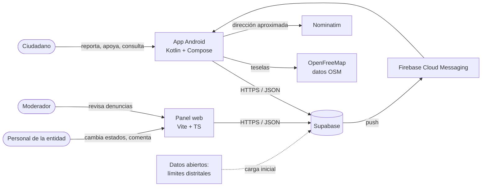
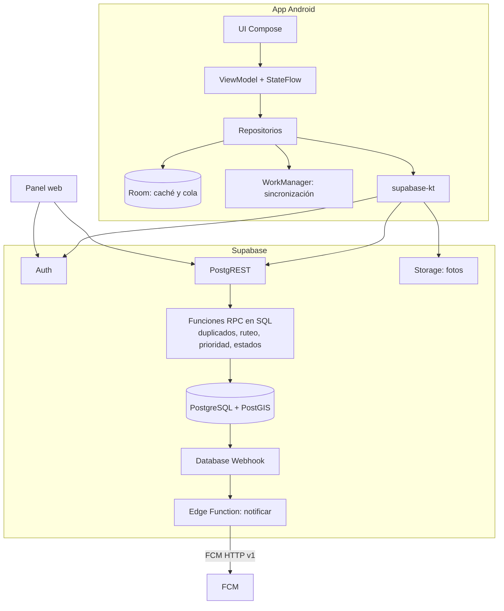
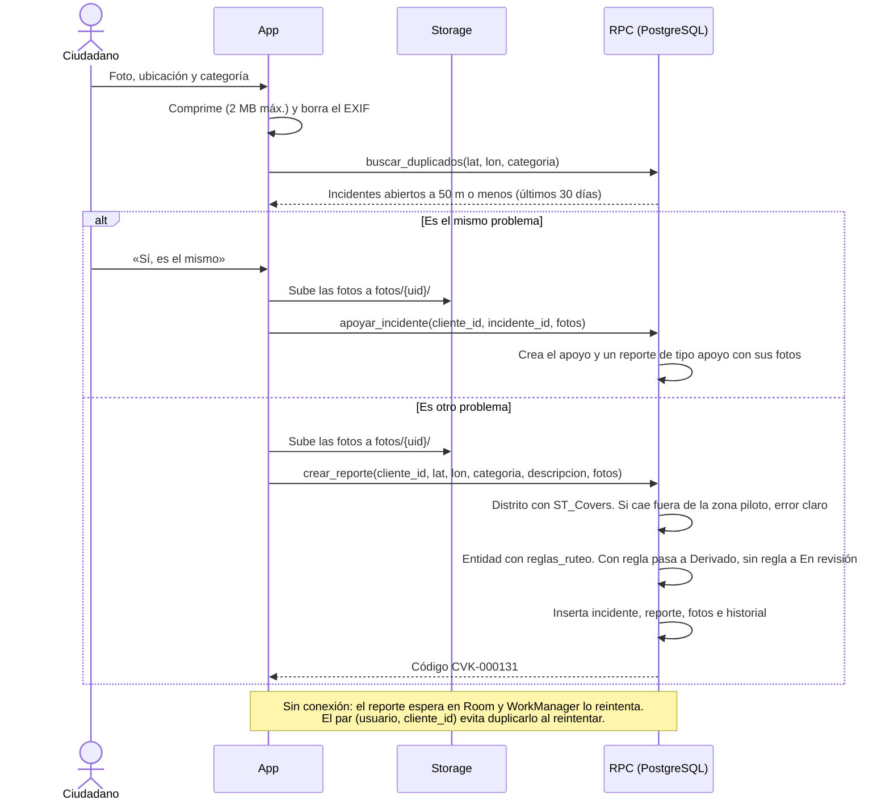
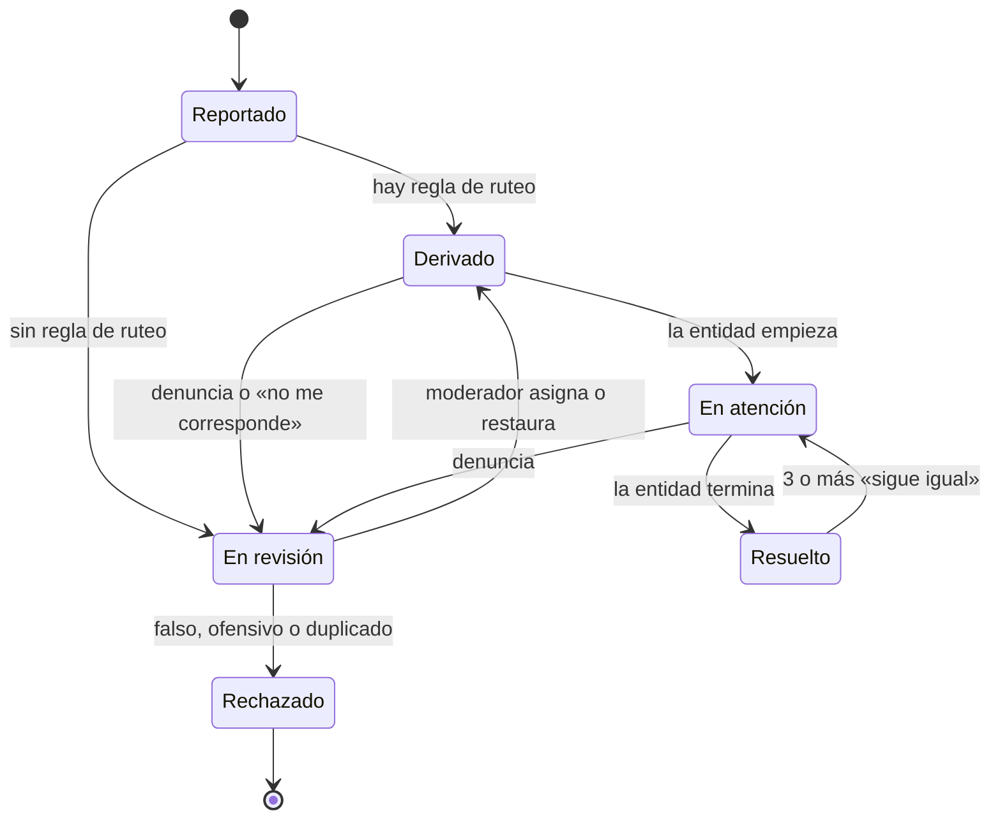
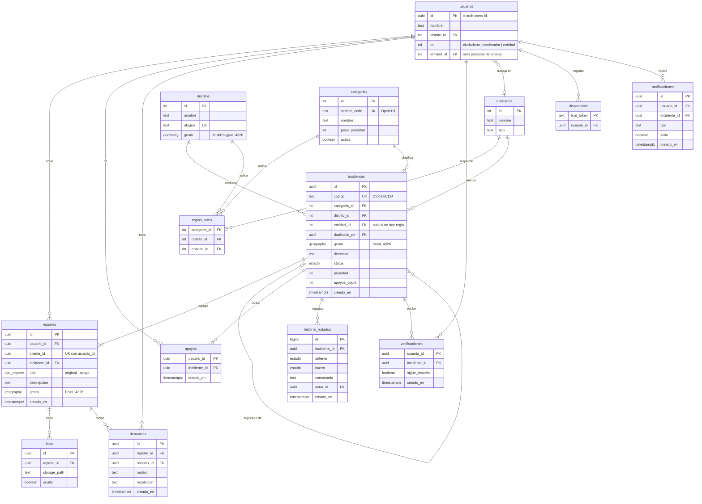

# Arquitectura de Cívika (MVP)

Este documento es la referencia técnica del equipo. Desarrolla el diseño de la sección 3.1.2 de los
[entregables](entregables-1-y-2.md#312-diseño-del-sistema): cómo encajan las piezas, qué datos hay, qué estados puede
tener un incidente, quién puede hacer qué y por qué se decidió cada cosa. Cuando una decisión cambie, se actualiza aquí
**antes** de cambiar el código.

## 1. Vocabulario del dominio

| Término | Qué es |
|---|---|
| **Reporte** | Lo que envía **un** ciudadano: fotos, ubicación, categoría y descripción. Un apoyo con foto también genera un reporte, de tipo `apoyo` |
| **Incidente** | El problema real en la calle. Agrupa uno o varios reportes del mismo problema |
| **Apoyo** | Un ciudadano dice «yo también lo vi». Hay uno como máximo por usuario e incidente |
| **Seguidores** | Los autores de los reportes de un incidente y los usuarios que lo apoyaron. Son quienes reciben las notificaciones (RF-11) |
| **Entidad** | Organización responsable de atender: municipalidad, empresa prestadora, etc. |
| **Regla de ruteo** | La regla (categoría + distrito) → entidad que decide a quién le toca un incidente |
| **Denuncia** | Aviso de un ciudadano de que un reporte es falso, ofensivo o repetido (RF-16) |
| **Verificación** | La respuesta de un seguidor a «¿sigue arreglado?» después de que un incidente se marca como resuelto |

La diferencia entre **reporte** e **incidente** es la base de la detección de duplicados. Si 30 vecinos ven el
mismo bache, hay 1 incidente con 30 apoyos (o con varios reportes), no 30 incidentes.

## 2. Contexto



## 3. Contenedores



## 4. Flujo principal: crear un reporte



**Distancias en metros:** los puntos se guardan como `geography(Point, 4326)`. Con `geometry` en 4326,
`ST_DWithin(a, b, 50)` mediría 50 **grados**, no metros. Con `geography`, el 50 sí son metros y el índice GiST
funciona igual.

**Idempotencia de la sincronización:** cada reporte lleva un `cliente_id` (UUID) que se genera en el celular. La
restricción única es (`usuario_id`, `cliente_id`), así que un usuario no puede chocar con el UUID de otro. La RPC hace
`INSERT … ON CONFLICT (usuario_id, cliente_id) DO NOTHING` y, si no insertó nada, devuelve el reporte que ya existía.
Al no haber un «comprueba y después inserta», tampoco hay condición de carrera entre dos reintentos simultáneos. Si
WorkManager reintenta tres veces, se crea **un solo** reporte.

**Validaciones de la RPC:** cada ruta de foto debe empezar por `{auth.uid()}/` y existir en el bucket. Además, la
categoría debe estar activa y el usuario no debe superar el límite anti-spam (sección 11).

## 5. Estados del incidente



La entidad se asigna **automáticamente** al crear el incidente (RF-06). La moderación no frena el flujo normal:
solo interviene cuando no hay regla de ruteo, cuando alguien denuncia un reporte (RF-16, en cualquier estado no
final) o cuando la entidad dice que no le corresponde.

| Transición | Quién la hace | Efecto |
|---|---|---|
| Reportado → Derivado | Sistema, dentro de `crear_reporte` | Notifica al autor |
| Reportado → En revisión | Sistema (no hay regla de ruteo) | Aparece en la cola de moderación |
| Derivado o En atención → En revisión | Sistema (al recibir una denuncia) o la entidad | Aparece en la cola de moderación |
| En revisión → Derivado | Moderador | Notifica a los seguidores |
| En revisión → Rechazado | Moderador | Notifica al autor con el motivo. Si es duplicado, se llena `duplicado_de` y sus reportes pasan al incidente original |
| Derivado → En atención | Personal de la entidad asignada | Notifica a los seguidores |
| En atención → Resuelto | Personal de la entidad asignada | Pregunta «¿sigue arreglado?» a los seguidores |
| Resuelto → En atención | Sistema (3 o más verificaciones «sigue igual») | Notifica a la entidad |

Cada transición se guarda en `historial_estados`, con su fecha. Solo se puede cambiar de estado con la RPC
`cambiar_estado`, que valida esta tabla. Nadie actualiza la columna `status` directamente.

## 6. Modelo de datos



Restricciones que no se ven en el diagrama:
- `reportes` es única por (`usuario_id`, `cliente_id`) y `reglas_ruteo` por (`categoria_id`, `distrito_id`).
- Hay índices GiST sobre `incidentes.geom`, `reportes.geom` y `distritos.geom`.
- `apoyos_count` lo mantiene un trigger. La app nunca lo escribe.
- El Entregable 2 nombraba una tabla `notificaciones`. Se mantiene como la bandeja de cada usuario (la pantalla de
  notificaciones), y los tokens de FCM se separan en `dispositivos`.
- Al marcar un incidente como resuelto se borran sus `verificaciones` anteriores, para que cada resolución se vote de cero.

**Prioridad (versión inicial, RF-09):** `prioridad = peso_prioridad × 10 + min(apoyos, 50) + días_abierto × 2`.
Se recalcula con un trigger cada vez que hay un apoyo, y una vez al día con `pg_cron`. Los pesos están en
`categorias`, así que se pueden ajustar sin tocar código (RNF-08).

**Tiempo promedio de atención (RF-14):** se calcula desde `historial_estados.creado_en` como la diferencia entre
la primera entrada «Reportado» y la última «Resuelto» de cada incidente.

## 7. Permisos por rol

RLS decide **qué filas** ve cada uno; no puede ocultar columnas. Por eso los datos sensibles se protegen con tres
mecanismos:

1. **Vistas** que exponen solo las columnas seguras. La app y el panel leen las vistas, no las tablas:
   - `incidentes_publicos`, sin `usuario_id` ni nombres.
   - `historial_publico`, sin `autor_id`.
   - `reportes_entidad`, sin `usuario_id`, solo para el personal de la entidad.
2. **RPC** para todas las escrituras con reglas de negocio.
3. Un **trigger** en `usuarios` que impide cambiar `rol` y `entidad_id` salvo desde migraciones o desde la cuenta de
   servicio. Así se evita que alguien se dé a sí mismo el rol de moderador.

L = leer, E = escribir, «RPC» = solo a través de una función que valida las reglas.

| Recurso | Anónimo | Ciudadano | Personal de entidad | Moderador |
|---|---|---|---|---|
| `incidentes_publicos` (vista) | L | L | L | L |
| `historial_publico` (vista) | L | L | L | L |
| `incidentes` (tabla) | — | E vía RPC | cambia estado vía RPC, solo los suyos | L; cambia estado vía RPC |
| `reportes` | — | L los propios; E vía RPC | L vía `reportes_entidad` | L |
| `fotos` (URL firmada vía RPC) | L si no está oculta | L; E en su carpeta `{uid}/` | L | L; puede ocultarlas |
| `apoyos` | — | E vía RPC y borrar el propio | — | L |
| `denuncias` | — | E | — | L y E |
| `verificaciones` | — | E la propia (si sigue el incidente) | — | L |
| `notificaciones` | — | L y marcar como leída las propias | — | — |
| `usuarios` | — | L y E la propia fila (`nombre`, `distrito_id`) | L la propia | L |
| `categorias`, `distritos`, `entidades` | L | L | L | L |

**Reglas para las funciones `security definer`** (las que se ejecutan con permisos de su dueño):
- Todas declaran `set search_path = ''` y usan nombres completos (`public.incidentes`). Así nadie puede colarles una
  tabla falsa por el `search_path`.
- Después de crearlas se hace `revoke execute … from public, anon` y se da `grant execute` solo a `authenticated`, o
  también a `anon` en las de lectura pública. Por defecto, PostgreSQL deja ejecutar cualquier función a todo el mundo.
- `rol_actual()` también es `security definer` y `stable`: lee `usuarios.rol` sin pasar por RLS, lo que evita la
  recursión infinita de una política de `usuarios` que se consulta a sí misma.
- El rol **siempre** sale de la tabla `usuarios`, nunca de `user_metadata` del token, porque ese campo lo puede editar
  el propio usuario.

## 8. Estructura de la app Android

Hay un solo módulo, `:app`, organizado en paquetes por funcionalidad. Las capas se respetan con paquetes e interfaces;
pasar a varios módulos después es mecánico si los paquetes están limpios.

```
pe.civika.app
├─ ui/theme/        Color.kt, Type.kt y Theme.kt (tokens de docs/diseno)
├─ ui/components/   SenalEstado, BotonPrincipal, TarjetaIncidente…
├─ core/            Resultado, errores, utilidades de fecha y ubicación
├─ data/
│  ├─ local/        Room: CivikaDb, DAOs, ReportePendienteEntity
│  ├─ remote/       supabase-kt y Retrofit (Nominatim)
│  └─ repository/   IncidenteRepository, ReporteRepository y sus implementaciones
├─ domain/          Modelos (Incidente, Estado, Categoria) y reglas puras con tests
├─ feature/
│  ├─ auth/  home/  mapa/  reporte/  incidente/  perfil/  notificaciones/
│  └─ (cada una con su Screen.kt, ViewModel.kt y UiState.kt)
├─ sync/            ReporteSyncWorker (WorkManager)
└─ di/              Módulos de Hilt
```

Reglas:
- Los ViewModels solo hablan con interfaces de repositorio, nunca directamente con Room ni con Supabase.
- Cada repositorio tiene una implementación `Fake…` con datos de ejemplo, para avanzar sin backend y para los tests.
- La lógica que se puede probar sin Android, como el orden de estados o el formato del código, va en `domain/`.

## 9. Entornos

| Entorno | Para qué | Cómo |
|---|---|---|
| **Local** | Desarrollo diario | `supabase start` (requiere Docker). El emulador de Android llega a la máquina en `http://10.0.2.2:54321` |
| **Demo** | Presentaciones y pruebas con usuarios | Un proyecto de Supabase en la nube, que solo Pieers despliega con `supabase db push` |

- Las migraciones de `supabase/migrations/` son la única forma de cambiar el esquema. Nadie lo edita a mano en el dashboard.
- `supabase/seed.sql` carga las categorías, las entidades de ejemplo y el polígono del distrito piloto.
- En el celular, cada build lee la URL y la clave `anon` desde `local.properties` (que no se sube al repo) mediante `BuildConfig`.

## 10. Estrategia de pruebas

| Nivel | Herramienta | Qué se prueba |
|---|---|---|
| Dominio | JUnit + kotlinx-coroutines-test | Reglas puras: estados permitidos, prioridad y formato del código |
| ViewModel | Turbine + repositorios fake | Que cada acción produzca el `UiState` correcto |
| Datos locales | Room en memoria | DAOs y la cola de reportes pendientes |
| UI | Compose UI Test | Flujo de reporte y etiquetas de accesibilidad |
| Base de datos | pgTAP (`supabase test db`) | `buscar_duplicados` (en metros), `crear_reporte` (idempotencia, fuera de zona y sin regla), `cambiar_estado`, las políticas RLS y el trigger que protege `rol` |
| Panel | Vitest + una prueba de humo con Playwright | Login y cambio de estado |

El CI (GitHub Actions) ejecuta el lint y los tests de Android, `supabase test db` y el build del panel en cada PR.

## 11. Seguridad y privacidad

- **Anti-spam:** `crear_reporte` acepta como máximo 10 reportes por usuario por hora y responde con un error claro si
  se supera.
- **Fotos:** en el celular se comprimen y se vuelven a codificar, lo que **borra el EXIF** (incluido el GPS de la
  cámara, que podría delatar el domicilio). El servidor no confía en eso: el bucket tiene `file_size_limit` de 2 MB y
  `allowed_mime_types` solo `image/jpeg` e `image/webp`.
- **Storage:** el bucket `fotos` es privado. Las fotos se leen con URLs firmadas que genera la RPC `urls_fotos`, con
  una duración de 10 minutos y omitiendo las fotos con `oculta = true`. Una URL ya entregada puede seguir funcionando
  hasta 10 minutos después de ocultar la foto; para una foto grave, el moderador la borra del bucket.
- **Claves:** la app y el panel solo usan la clave `anon`. La `service_role` vive solo en los secretos de las Edge
  Functions.
- **Datos personales (RNF-05):** el mapa público nunca muestra quién reportó. Se pide consentimiento al registrarse,
  y ese texto avisa que la ubicación se envía a Nominatim (OpenStreetMap) para obtener la dirección. Se guarda solo
  lo necesario: nombre, correo y distrito.
- **No es un canal de emergencias:** la app lo recuerda en la bienvenida y en el flujo de reporte.

## 12. Decisiones (ADR)

Cada decisión registra el contexto, lo que se decidió y lo que implica. Si se cambia una, se añade una nueva que la
reemplace; no se borra la anterior.

### ADR-1. Supabase como backend
- **Contexto:** hay 8 semanas y 5 personas; un backend propio (Spring Boot) consumiría el tiempo en infraestructura.
- **Decisión:** usar Supabase (Postgres, Auth, Storage y Edge Functions), como ya dice el Entregable 2.
- **Consecuencias:** la lógica de negocio vive en SQL y en RLS, que tienen que revisarse con el mismo cuidado que el
  código. Migrar después es posible porque, en el fondo, todo es PostgreSQL estándar.

### ADR-2. Lógica geoespacial en funciones RPC de SQL
- **Contexto:** los duplicados, el ruteo y la prioridad necesitan PostGIS y deben ser atómicos.
- **Decisión:** programarlos como funciones de PostgreSQL. Las Edge Functions quedan solo para integraciones externas (FCM).
- **Consecuencias:** una sola transacción y menos viajes por red. Las funciones se prueban con pgTAP y siguen las
  reglas de `security definer` de la sección 7.

### ADR-3. Mapa con MapLibre y teselas de OpenFreeMap
- **Contexto:** la política de uso de `tile.openstreetmap.org` no permite que lo use una app con tráfico real, y
  Google Maps exige una API key de pago.
- **Decisión:** MapLibre Native para Android, con teselas vectoriales de OpenFreeMap (gratis y sin API key). Para la
  geocodificación inversa se usa la instancia pública de Nominatim, solo una vez por reporte confirmado, con un
  User-Agent propio (`Civika/0.1 (contacto del proyecto)`), un máximo de 1 consulta por segundo y caché en Room.
- **Consecuencias:** hay que mostrar la atribución «OpenFreeMap © OpenMapTiles Data from OpenStreetMap». La instancia
  pública de Nominatim no está pensada para mucho tráfico: si la app crece, se pasa a una instancia propia o a un
  proveedor de pago. Si OpenFreeMap fallara, se cambia la URL del estilo a otro proveedor, como MapTiler, que sí pide
  API key, sin tocar el resto del código.

### ADR-4. Un solo módulo `:app` con paquetes por funcionalidad
- **Contexto:** separar en varios módulos mejora el tiempo de compilación en equipos grandes, pero añade
  configuración de Gradle.
- **Decisión:** usar un solo módulo con la estructura de la sección 8.
- **Consecuencias:** se empieza más rápido. Hay que mantener la disciplina de que los ViewModels solo usen interfaces.

### ADR-5. supabase-kt como cliente y Retrofit para APIs externas
- **Contexto:** supabase-kt ya resuelve la autenticación, la renovación del token, Storage y las llamadas RPC.
- **Decisión:** usar supabase-kt para todo lo de Supabase, y Retrofit para APIs externas como Nominatim, tal como
  prevé el Entregable 2.
- **Consecuencias:** se valida en el Sprint 1 revisando con context7 la versión vigente de supabase-kt y su
  compatibilidad con Ktor y Android.

### ADR-6. Envío sin conexión con cola local e idempotencia
- **Contexto:** RF-15 y RNF-11 piden que un reporte no se pierda si no hay señal.
- **Decisión:** primero se guarda en Room y después lo envía WorkManager, con un `cliente_id` generado en el celular
  y único por usuario.
- **Consecuencias:** se tolera que WorkManager reintente sin crear duplicados, y la UI muestra el estado «Pendiente de
  envío».

### ADR-7. Notificaciones mediante Database Webhook, Edge Function y FCM
- **Contexto:** cada cambio de estado debe avisar a los seguidores del incidente (RF-11).
- **Decisión:** un webhook sobre el `INSERT` en `historial_estados` llama a la Edge Function `notificar`, que guarda
  la notificación en `notificaciones`, busca los tokens de los seguidores en `dispositivos` y envía con FCM HTTP v1.
- **Consecuencias:** las credenciales de Firebase viven solo en los secretos de la Edge Function. Si FCM falla, el
  cambio de estado ya quedó guardado igual, porque la notificación no bloquea la transacción.

### ADR-8. Ruteo automático y moderación por excepción
- **Contexto:** RF-06 pide asignar la entidad automáticamente. Si todo reporte esperara a un moderador, el flujo se
  frenaría.
- **Decisión:** `crear_reporte` deriva el incidente en el acto cuando hay regla de ruteo. La moderación revisa solo lo
  que no tiene regla, lo denunciado y lo que la entidad rechaza.
- **Consecuencias:** un reporte falso puede quedar visible hasta que alguien lo denuncie. Lo mitigan el límite
  anti-spam, las denuncias y la posibilidad de ocultar fotos.
