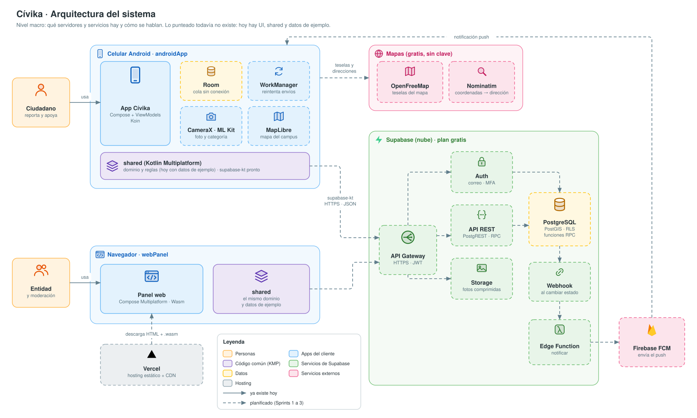
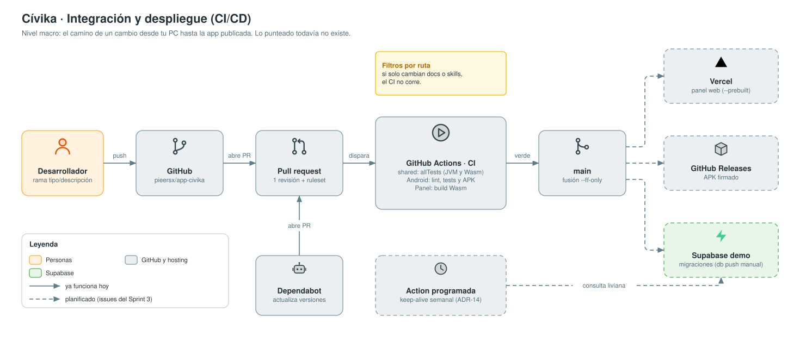
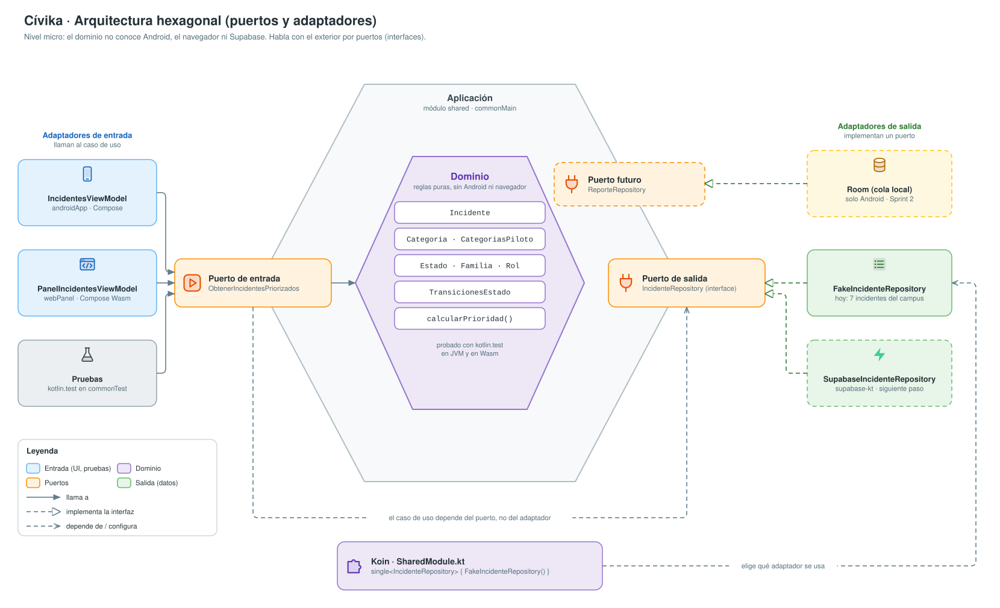
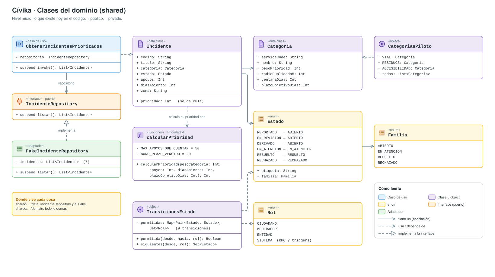
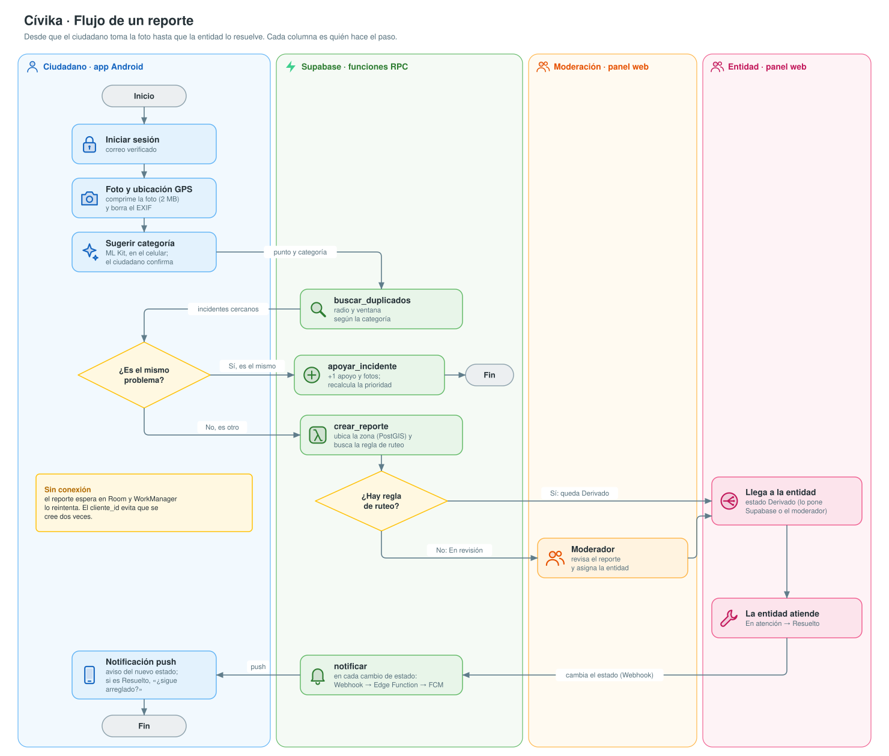

# Diagramas de Cívika

Cinco diagramas, de lo general a lo concreto:
- Los dos primeros son **macro**: qué piezas hay y cómo se conectan.
- El 3 y el 4 son **micro**: cómo está organizado el código por dentro.
- El 5 es el **proceso**: qué pasa con un reporte, paso a paso.

El detalle de cada decisión está en [arquitectura.md](../arquitectura.md).

## 1. Arquitectura del sistema (macro)

Qué servidores y servicios hay y quién habla con quién: el celular, el panel web, Supabase y los servicios externos.
Es el diseño objetivo. Hoy solo existen la interfaz, `shared` y los datos de ejemplo; lo demás está punteado.

## 2. Integración y despliegue (macro)

El camino de un cambio desde tu PC hasta la app publicada. Lo punteado está planificado y todavía no existe.

## 3. Arquitectura hexagonal (micro)

El dominio está en el centro y no conoce Android, el navegador ni Supabase. Se comunica con el exterior a través de
**puertos** (interfaces) y **adaptadores** (sus implementaciones). Koin decide qué adaptador se usa.

## 4. Clases del dominio (micro)

Las clases que existen hoy en `shared`, con sus atributos y relaciones. En `Estado`, la flecha de cada valor
(`REPORTADO → ABIERTO`) indica su `familia`, no una transición. Las transiciones están en `TransicionesEstado`.

## 5. Flujo de un reporte (proceso)

El camino principal desde que el ciudadano toma la foto hasta que la entidad lo resuelve. Cada columna (carril) es quién
hace el paso: el ciudadano, Supabase, la moderación o la entidad. Los rombos son decisiones. Derivado y En revisión
son estados del incidente (ver [arquitectura.md §5](../arquitectura.md#5-estados-del-incidente)). Para no recargarlo,
no muestra la subida de fotos a Storage, los errores (por ejemplo, fuera de la zona piloto) ni el rechazo de un reporte.

> Para el informe del curso sigue vigente la [Figura 2 v2](../img/v2/flujo-reporte.svg), con el estilo formal de los
> entregables. Este diagrama es la versión para el equipo: con íconos y editable.

## Palabras que aparecen

| Término | Qué significa aquí |
|---|---|
| Macro / micro | Macro: las piezas grandes (apps, servidores, servicios). Micro: cómo está organizado el código por dentro. |
| KMP | Kotlin Multiplatform: el mismo código Kotlin (`shared`) funciona en Android y en el navegador. |
| CI/CD | Integración continua (probar y compilar cada cambio) y despliegue continuo (publicarlo de forma automática). |
| JWT | El «pase» firmado que Supabase entrega al iniciar sesión; cada petición lo lleva para saber quién eres. |
| RLS | *Row Level Security*: reglas de PostgreSQL que deciden qué filas puede ver o cambiar cada usuario. |
| Carril (*swimlane*) | Columna de un diagrama de flujo que agrupa los pasos que hace un mismo actor. |
| Puerto / adaptador | El puerto es una interfaz (`IncidenteRepository`); el adaptador es una clase que la implementa (`FakeIncidenteRepository`). |

## Cómo editarlos

Cada archivo `.drawio.svg` es a la vez una imagen (GitHub la muestra tal cual) y un diagrama editable de draw.io.
Ábrelo con draw.io, no con un editor de imágenes: un editor de imágenes borra el diagrama editable que va dentro.

- **En VS Code:** instala la extensión *Draw.io Integration* (`hediet.vscode-drawio`) y abre el archivo. Al guardar,
  la imagen se actualiza sola.
- **En el navegador:** entra a [app.diagrams.net](https://app.diagrams.net), abre el archivo desde tu PC y guárdalo
  con el mismo nombre y formato (`.drawio.svg`).

Reglas:

- Cuando cambie la arquitectura, actualiza primero [arquitectura.md](../arquitectura.md) y después el diagrama.
- Respeta los colores por tipo: personas en naranja, apps en azul, código común en morado, Supabase en verde, datos en
  amarillo, servicios externos en rosa e infraestructura en gris.
- En los diagramas 1 y 2, todo lo punteado (recuadros y flechas) está planificado; lo continuo ya existe.
- En los diagramas 3 y 4, un **recuadro** punteado está planificado. Las **flechas** siguen la convención UML: la
  punteada significa «usa / depende de» y la que termina en triángulo hueco, «implementa».
- Los íconos de Supabase, Vercel y Firebase son formas simples que solo sirven para reconocer cada servicio.
