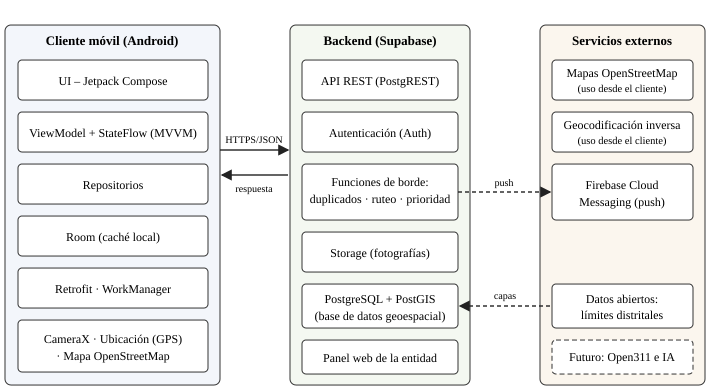
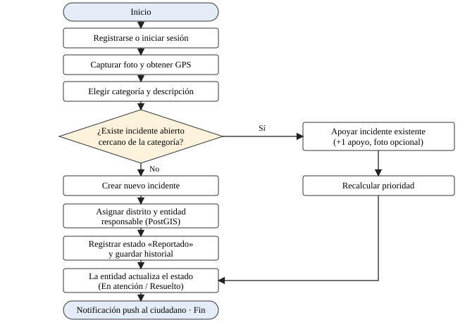

# Cívika: Gestión Inteligente de Incidencias Urbanas — Entregables 1 y 2

**Universidad Nacional Mayor de San Marcos** · Facultad de Ingeniería de Sistemas e Informática
Escuela Académica Profesional de Ingeniería de Sistemas

- **Asignatura:** Desarrollo de Sistemas Móviles
- **Docente:** Gelber Uscuchagua Flores
- **Grupo 10:** Cerna Aguilar, Emily Andrea · Flores Cortez, Valeria Alexandra · Sihuacollo Sierra, Keyla Noemi ·
  Pachas Auris, Pieers Fernando · Chavez Chacon, Alex Junior
- **Lugar y semestre:** Lima, Perú. Semestre 2026-II

> Versión en Markdown del PDF entregado al curso. Es el mismo contenido, sin los datos de contacto de los integrantes.
> Es el **registro histórico** de lo que se entregó y no se modifica. Las decisiones vigentes (Kotlin Multiplatform,
> zona piloto en la Ciudad Universitaria, ML Kit, etc.) están en
> [arquitectura.md, «Cambios respecto a los entregables»](arquitectura.md#13-cambios-respecto-a-los-entregables).

## Índice

- [Introducción](#introducción)
- [Capítulo I: Generalidades](#capítulo-i-generalidades)
- [Capítulo II: Descripción del proyecto](#capítulo-ii-descripción-del-proyecto)
- [Capítulo III: Desarrollo técnico](#capítulo-iii-desarrollo-técnico)
- [Referencias](#referencias)

---

## Introducción

Cuando una persona encuentra en la ciudad un bache, un poste sin iluminación, una rampa bloqueada o basura acumulada,
rara vez sabe a qué entidad corresponde resolverlo y por qué canal debe reportarlo. La responsabilidad sobre los
servicios urbanos está repartida entre municipalidades distritales y provinciales, empresas prestadoras y entidades
sectoriales, y los canales de atención suelen ser dispersos, sin seguimiento visible para el ciudadano.

Cívika es una plataforma móvil que busca cerrar esa brecha: el ciudadano fotografía el problema, la aplicación obtiene
su ubicación, identifica la entidad responsable, consolida los reportes repetidos de un mismo problema en un único
incidente validado por otros ciudadanos y permite seguir su atención hasta la solución. Su diseño toma como referentes
internacionales a FixMyStreet y SeeClickFix, el estándar abierto Open311 y el modelo colaborativo de Waze, adaptados a
la organización de los servicios públicos en el Perú.

El presente documento reúne el Entregable N.º 1 (Capítulos I y II: generalidades y descripción del proyecto) y el
Entregable N.º 2 (Capítulo III: desarrollo técnico, con análisis de requisitos y diseño del sistema) del curso
Desarrollo de sistemas móviles, cuyo producto se desarrollará en el lenguaje Kotlin.

## Capítulo I: Generalidades

### 1.1 Descripción del sector

Cívika se ubica en el sector de la tecnología cívica y el gobierno digital aplicado a la gestión de servicios urbanos
locales. En el Perú, la Ley Orgánica de Municipalidades asigna a los gobiernos locales funciones de saneamiento,
limpieza pública y manejo de residuos sólidos, entre otras competencias sobre los servicios públicos locales (Congreso
de la República del Perú, 2003). Otros servicios, como el agua potable o la energía, pueden depender de empresas
prestadoras o entidades sectoriales, lo que fragmenta el punto de contacto del ciudadano.

El marco de transformación digital del Estado favorece este tipo de soluciones. El Decreto Legislativo N.º 1412, Ley de
Gobierno Digital, establece el marco para la gestión de servicios digitales, la interoperabilidad y los datos
(Presidencia de la República del Perú, 2018).

Existe además una base tecnológica adecuada: en el cuarto trimestre de 2025, el 95,7 % de los hogares del país y el
98,4 % de los de Lima Metropolitana contaban con telefonía móvil, y el 89,2 % de la población usuaria de internet
accedió a través del celular (Instituto Nacional de Estadística e Informática [INEI], 2026). A nivel de referentes, el
aplicativo Reporta Residuos del Organismo de Evaluación y Fiscalización Ambiental (OEFA) ya recibe alertas ciudadanas
con fotografía y ubicación sobre acumulación de basura (OEFA, s. f.), y en el ámbito internacional operan plataformas
como FixMyStreet (mySociety) y SeeClickFix (CivicPlus).

### 1.2 ¿Qué es el proyecto Cívika?

Cívika es una aplicación móvil Android, desarrollada en Kotlin, que permite a cualquier ciudadano reportar en pocos
segundos un problema urbano y hacerle seguimiento hasta su solución. Su flujo central es:
**foto → ubicación GPS → clasificación → entidad responsable → validación ciudadana → seguimiento hasta la solución.**

La plataforma se compone de tres elementos: (a) la aplicación móvil ciudadana; (b) un backend con base de datos
geoespacial que consolida incidentes, determina la entidad responsable y envía notificaciones; y (c) un panel web básico
para que la entidad actualice el estado de los incidentes. Para esta etapa, el producto mínimo viable (MVP) se limita a
Lima Metropolitana y a tres categorías: infraestructura vial (baches), residuos y accesibilidad (rampas y veredas).

### 1.3 Importancia del proyecto

#### Impacto del proyecto en la sociedad

- **Acceso simple al reporte:** el ciudadano no necesita saber qué entidad es responsable; la aplicación la determina
  por ubicación y categoría, principio que ya aplica FixMyStreet (Myfanwy, 2012).
- **Trazabilidad:** cada incidente muestra su estado, historial y entidad asignada, de modo que el ciudadano deja de
  reportar «a ciegas».
- **Participación ciudadana:** los vecinos apoyan incidentes existentes en lugar de duplicarlos, con lo cual se
  refuerza la prioridad de los problemas más sentidos.
- **Inclusión:** el módulo de accesibilidad permite visibilizar barreras urbanas que afectan a personas con
  discapacidad y movilidad reducida, en línea con la Ley General de la Persona con Discapacidad (Congreso de la
  República del Perú, 2012).

#### Carácter innovador

La innovación de Cívika no está en reportar problemas, algo que ya existe, sino en cómo se procesa y se hace visible la
información:

- **Incidente único por inteligencia colectiva:** los reportes de la misma categoría, cercanos en ubicación y en el
  tiempo se consolidan en un solo incidente con número de apoyos, fotografías y antigüedad. Plataformas comerciales
  ofrecen gestión de duplicados para el personal municipal (CivicPlus, s. f.); Cívika lo orienta también al ciudadano,
  que ve y apoya el incidente existente.
- **Entidad responsable automática** según ubicación y categoría, y no solo recepción de reclamos.
- **Transparencia comparable:** indicadores públicos por entidad (reportes recibidos, resueltos y tiempo promedio de
  atención) calculados a partir de los datos de la plataforma.
- **Multicategoría:** mientras Reporta Residuos se concentra en un solo problema (OEFA, s. f.), Cívika integra varias
  categorías en un único mapa, incluida la accesibilidad.
- **Arquitectura abierta:** modelo de datos alineado con Open311, que facilita la integración futura con sistemas
  municipales (Open311, s. f.).

#### Beneficio social y económico

**Social:** mejora la comunicación entre ciudadanía y entidades, promueve el control social y contribuye a que los
problemas de seguridad y accesibilidad en el espacio público se atiendan con mayor oportunidad. **Económico:** para las
entidades, reduce el tiempo de verificación de reportes repetidos y ayuda a priorizar cuadrillas y presupuesto con
datos geolocalizados; para la sociedad, un mantenimiento más temprano evita que el deterioro de la infraestructura se
agrave. A futuro, el modelo puede sostenerse con una versión gratuita para el ciudadano y un servicio de panel de
gestión para entidades, esquema similar al de las plataformas comerciales de solicitudes de servicio (CivicPlus, s. f.).

## Capítulo II: Descripción del proyecto

### 2.1 Título del proyecto

**Cívika: Plataforma móvil inteligente y colaborativa para el reporte, seguimiento y gestión de incidencias urbanas
mediante geolocalización y participación ciudadana.**

### 2.2 Realidad problemática

En las ciudades del Perú, los problemas del espacio público (baches, veredas deterioradas, falta de rampas, basura
acumulada, alumbrado deficiente) se reportan por canales distintos según la entidad, y el ciudadano normalmente
desconoce a cuál dirigirse. La competencia sobre los servicios está repartida entre municipalidades y otras entidades
(Congreso de la República del Perú, 2003), por lo que un mismo tipo de problema puede tener responsables diferentes
según su naturaleza y ubicación.

Hay evidencia de que el ciudadano peruano está dispuesto a reportar desde el celular cuando existe un canal sencillo.
El aplicativo Reporta Residuos de OEFA recibió 3,836 alertas ciudadanas válidas sobre acumulación de basura hasta
septiembre de 2025, de las cuales más del 77 % fueron atendidas por municipalidades (Agencia Andina, 2025), y en abril
de 2026 se informó de 5,052 alertas válidas en el último año, con más del 69 % atendidas (Energiminas, 2026). Estas
cifras muestran la demanda de reporte ciudadano, pero también que una parte de las alertas no recibe atención, y que la
herramienta cubre un único tipo de problema.

La experiencia internacional apunta en la misma dirección: en el Reino Unido, FixMyStreet reunió más de 87,000 usuarios
en sus primeros años, el 52 % de los cuales nunca había reportado un problema al municipio (Myfanwy, 2012), lo que
indica que un canal simple amplía la participación.

A partir de este contexto, el equipo identifica los siguientes problemas:

1. El ciudadano desconoce qué entidad es responsable de cada tipo de incidente.
2. Los canales de reporte están dispersos y no comparten información.
3. Muchos ciudadanos reportan el mismo problema sin que los reportes se consoliden ni se priorice según su recurrencia.
4. No hay seguimiento visible del estado de un reporte hasta su solución.
5. No existe información pública y comparable sobre la atención que brinda cada entidad.
6. Las barreras de accesibilidad en el espacio público rara vez se registran de forma sistemática.

### 2.3 Definición del problema

Los ciudadanos de Lima Metropolitana carecen de un canal único, geolocalizado y con seguimiento que les permita
reportar incidentes urbanos a la entidad responsable, validarlos colectivamente y conocer su estado de atención, lo que
genera reportes duplicados, falta de trazabilidad y baja visibilidad de los problemas que requieren atención
prioritaria.

**Tabla 1.** *Causas, problema central y efectos*

| Causas | Problema central | Efectos |
|---|---|---|
| Responsabilidad repartida entre varias entidades; canales dispersos; ausencia de consolidación de reportes. | Falta de un canal único, geolocalizado y con seguimiento para reportar incidentes urbanos. | Reportes duplicados; problemas sin atender o atendidos tardíamente; desconfianza ciudadana; datos urbanos poco aprovechables. |

*Nota.* Elaboración propia.

### 2.4 Conexión con los Objetivos de Desarrollo Sostenible (ODS)

Cívika contribuye a los siguientes objetivos de la Agenda 2030 (Naciones Unidas, 2015):

**Tabla 2.** *Relación de Cívika con los ODS*

| ODS | Metas relacionadas | Contribución de Cívika |
|---|---|---|
| ODS 9. Industria, innovación e infraestructura | 9.1 Infraestructuras fiables, sostenibles, resilientes y de calidad. 9.c Acceso a las tecnologías de la información y las comunicaciones. | Aporta información ciudadana geolocalizada sobre el deterioro de la infraestructura para un mantenimiento oportuno, mediante una herramienta TIC accesible desde el celular. |
| ODS 11. Ciudades y comunidades sostenibles | 11.3 Urbanización inclusiva y gestión participativa. 11.7 Espacios públicos seguros, inclusivos y accesibles. | Facilita la participación vecinal en la gestión del espacio público y visibiliza barreras de accesibilidad, residuos y daños en vías. |
| ODS 16. Paz, justicia e instituciones sólidas | 16.6 Instituciones eficaces y transparentes que rindan cuentas. 16.7 Decisiones inclusivas y participativas. | Publica el estado de cada incidente y la atención de cada entidad, y abre un canal de participación directa del ciudadano. |

*Nota.* Elaboración propia con base en Naciones Unidas (2015).

### 2.5 Antecedentes

Se revisaron soluciones nacionales e internacionales que sirven de base conceptual para Cívika:

**Tabla 3.** *Soluciones de referencia*

| Solución | Descripción | Aporte y diferencia con Cívika |
|---|---|---|
| FixMyStreet (Reino Unido, desde 2007) | Plataforma de mySociety donde el ciudadano marca un problema en el mapa y el sistema lo envía a la autoridad responsable; los reportes son públicos (Myfanwy, 2012). Es de código abierto y compatible con Open311 (Banco Interamericano de Desarrollo [BID], s. f.). | Aporta el enrutamiento por ubicación y categoría y la visibilidad pública. Cívika añade consolidación de incidentes, validación ciudadana e indicadores por entidad adaptados a Perú. |
| SeeClickFix / CivicPlus 311 CRM (EE. UU.) | Solución para gobiernos locales que centraliza solicitudes de residentes, las asigna según ubicación y categoría, gestiona duplicados y permite comunicación bidireccional (CivicPlus, s. f.). | Aporta el enfoque de gestión para la entidad. Cívika prioriza la experiencia móvil del ciudadano y un panel básico para la entidad. |
| Open311 | Estándar abierto (GeoReport v2) para consultar servicios, crear solicitudes y consultar su estado en problemas urbanos no urgentes, como baches o grafitis (Open311, s. f.). | Cívika alinea su modelo de datos a este estándar para facilitar interoperabilidad futura. |
| Waze | Aplicación de navegación comunitaria donde los propios conductores reportan incidentes de tránsito (Waze, s. f.). | Inspira el modelo de «ciudadanos como sensores» y la validación colectiva de reportes. |
| Reporta Residuos (OEFA, Perú) | Aplicativo gratuito que permite fotografiar y ubicar puntos de acumulación de residuos, con mapa y seguimiento de la atención municipal (OEFA, s. f.; Energiminas, 2026). | Valida el comportamiento de reporte en Perú. Cívika amplía el alcance a múltiples categorías y consolida incidentes. |

*Nota.* Elaboración propia.

### 2.6 Marco teórico

**Participación ciudadana y gobierno digital.** El gobierno digital busca que los servicios públicos se presten mediante
tecnologías digitales interoperables y centradas en el ciudadano, y en el Perú se encuentra regulado por el Decreto
Legislativo N.º 1412 (Presidencia de la República del Perú, 2018). Los canales de reporte digital son una forma de
participación que acerca al ciudadano a la gestión local.

**Ciudadanos como sensores y crowdsourcing.** Goodchild (2007) describe a los ciudadanos como una red de sensores que
aporta información geográfica voluntaria, y Brabham (2013) define el crowdsourcing como un modelo de producción
distribuida en línea que aprovecha la contribución de muchas personas. Ambos conceptos sustentan el reporte, el apoyo
colectivo y la consolidación de incidentes en Cívika.

**Gestión de solicitudes de servicio y Open311.** Open311 define un estándar para que aplicaciones ciudadanas y
gobiernos intercambien solicitudes de servicio georreferenciadas y sus estados (Open311, s. f.). Cívika adopta sus
conceptos de servicio (categoría), solicitud (incidente) y estado.

**Geolocalización y datos geoespaciales.** La ubicación del dispositivo se obtiene mediante los servicios de ubicación
de Android (Android Developers, s. f.-a). Los datos se almacenan en PostgreSQL con la extensión PostGIS, que permite
consultas espaciales como la búsqueda de incidentes cercanos (PostGIS, s. f.), y los mapas se basan en OpenStreetMap,
un mapa colaborativo de datos abiertos (OpenStreetMap, s. f.).

**Desarrollo móvil nativo con Kotlin.** Kotlin es el lenguaje recomendado para el desarrollo Android (JetBrains, s. f.).
La interfaz se construye con Jetpack Compose (Android Developers, s. f.-b), se organiza con la arquitectura recomendada
por Android basada en capas y el patrón MVVM (Android Developers, s. f.-c), usa Room para el almacenamiento local
(Android Developers, s. f.-d) y CameraX para la captura de fotografías (Android Developers, s. f.-e).

### 2.7 Objetivos

#### Objetivo general

Diseñar y desarrollar una aplicación móvil Android en Kotlin que permita a los ciudadanos de Lima Metropolitana
reportar, apoyar y dar seguimiento a incidencias urbanas geolocalizadas, asignándolas a la entidad responsable y
consolidando los reportes repetidos en un único incidente.

#### Objetivos específicos

1. Analizar la problemática y los referentes existentes para definir las categorías y los requisitos del MVP.
2. Diseñar la arquitectura de la solución (aplicación móvil, backend y servicios) y el modelo de datos geoespacial.
3. Implementar el flujo completo de reporte: captura de fotografía, ubicación GPS, categoría, almacenamiento local y
   sincronización.
4. Implementar la detección de incidentes duplicados, el apoyo ciudadano y la asignación de la entidad responsable por
   ubicación y categoría.
5. Implementar el mapa de incidentes, el seguimiento de estados y las notificaciones push.
6. Validar el MVP mediante pruebas funcionales y de usabilidad con usuarios.

### 2.8 Alcance y limitaciones

#### Alcance

- **Geográfico:** Lima Metropolitana, con enfoque inicial en una zona piloto.
- **Categorías:** infraestructura vial (baches), residuos y accesibilidad (rampas y veredas).
- **Plataforma:** aplicación nativa Android en Kotlin, backend en la nube y panel web básico para actualizar estados.
- **Funcionalidades:** registro, reporte con foto y GPS, detección de duplicados, apoyo ciudadano, mapa, seguimiento y
  notificaciones.

#### Limitaciones

- No incluye versión para iOS ni integración oficial con los sistemas de las entidades; los cambios de estado se
  registran desde el panel básico.
- Cívika no garantiza la atención de los reportes, que depende de cada entidad, y no es un canal de emergencias.
- La clasificación automática de imágenes con inteligencia artificial queda como evolución futura; en el MVP la
  categoría la elige el usuario.
- Los indicadores por entidad son referenciales, pues se basan solo en los reportes registrados en la plataforma y no
  constituyen una evaluación oficial.
- La calidad de los datos depende de los usuarios y de la precisión del GPS y de la conectividad del dispositivo.

## Capítulo III: Desarrollo técnico

### 3.1 Fases del proyecto

El proyecto se desarrollará con un enfoque iterativo e incremental, en las fases que muestra la Tabla 4. Este
entregable corresponde a la fase de análisis y diseño.

**Tabla 4.** *Fases del proyecto*

| N.º | Fase | Actividades principales |
|---|---|---|
| 1 | Descripción del proyecto (Entregable N.º 1) | Justificación, problema, ODS, antecedentes, marco teórico, objetivos, alcance y limitaciones. |
| 2 | Análisis y diseño (Entregable N.º 2) | Requisitos funcionales y no funcionales, arquitectura, diagrama de flujo y limitaciones del sistema. |
| 3 | Desarrollo del MVP | Implementación de la aplicación Kotlin, el backend, la base de datos geoespacial y el panel básico. |
| 4 | Pruebas y validación | Pruebas unitarias, funcionales y de usabilidad con usuarios en la zona piloto. |
| 5 | Cierre | Correcciones, documentación final y presentación del proyecto. |

*Nota.* Elaboración propia.

### 3.1.1 Análisis de requisitos

Los requisitos se redactaron siguiendo las pautas de ISO/IEC/IEEE 29148 (2018) e identifican a cuatro actores: el
ciudadano, el moderador, el personal de la entidad (usuario del panel web) y el sistema. La prioridad se expresa como
Alta (A), Media (M) o Baja (B).

#### Requisitos funcionales

**Tabla 5.** *Requisitos funcionales*

| ID | Requisito | Prior. |
|---|---|---|
| RF-01 | El sistema debe permitir al ciudadano registrarse e iniciar sesión con correo electrónico y contraseña. | A |
| RF-02 | El sistema debe permitir capturar hasta tres fotografías del incidente con la cámara del dispositivo. | A |
| RF-03 | El sistema debe obtener la ubicación GPS automáticamente y permitir ajustarla en el mapa. | A |
| RF-04 | El sistema debe permitir elegir la categoría (infraestructura vial, residuos, accesibilidad) y añadir una descripción opcional. | A |
| RF-05 | El sistema debe buscar incidentes abiertos cercanos de la misma categoría antes de crear uno nuevo y proponer apoyarlo. | A |
| RF-06 | El sistema debe crear el incidente y asignar automáticamente el distrito y la entidad responsable según ubicación y categoría. | A |
| RF-07 | El sistema debe permitir apoyar un incidente existente (un apoyo por usuario) y agregar fotografías. | A |
| RF-08 | El sistema debe mostrar un mapa de incidentes con filtros por categoría y estado. | A |
| RF-09 | El sistema debe calcular la prioridad del incidente según apoyos, antigüedad y categoría. | M |
| RF-10 | El sistema debe mostrar el detalle de cada incidente y su historial de estados (Reportado, En revisión, Derivado, En atención, Resuelto, Rechazado). | A |
| RF-11 | El sistema debe enviar notificaciones push al ciudadano cuando cambie el estado de un incidente que reportó o apoyó. | A |
| RF-12 | El sistema debe permitir al ciudadano consultar sus reportes. | M |
| RF-13 | El sistema debe ofrecer un panel web para que la entidad actualice estados y agregue comentarios. | M |
| RF-14 | El sistema debe mostrar indicadores públicos por distrito (reportes recibidos, resueltos y tiempo promedio de atención). | M |
| RF-15 | El sistema debe guardar reportes sin conexión y sincronizarlos al recuperar internet. | M |
| RF-16 | El sistema debe permitir denunciar contenido inapropiado o falso, y que el moderador lo revise, apruebe, rechace o marque como duplicado. | M |

*Nota.* Elaboración propia.

#### Requisitos no funcionales

**Tabla 6.** *Requisitos no funcionales*

| ID | Categoría | Requisito |
|---|---|---|
| RNF-01 | Usabilidad | Un usuario debe poder completar un reporte en menos de un minuto y en no más de cinco pasos. |
| RNF-02 | Rendimiento | El mapa debe cargar en menos de 3 segundos en red 4G con hasta 500 incidentes visibles (valor objetivo). |
| RNF-03 | Disponibilidad | El servicio debe apuntar a una disponibilidad mensual mayor o igual al 99 %, sujeta al proveedor en la nube. |
| RNF-04 | Seguridad | Toda comunicación debe usar HTTPS/TLS; el acceso debe controlarse con autenticación por token, roles (ciudadano, moderador, personal de la entidad) y reglas de acceso por fila en la base de datos. |
| RNF-05 | Privacidad | El tratamiento de datos personales debe cumplir la Ley N.º 29733 y su reglamento (Congreso de la República del Perú, 2011; Decreto Supremo N.º 016-2024-JUS, 2024): consentimiento informado, recolección mínima y sin exponer datos personales del reportante en el mapa público. |
| RNF-06 | Compatibilidad | La aplicación debe funcionar en dispositivos con Android 8.0 (API 26) o superior. |
| RNF-07 | Accesibilidad | La interfaz debe ser compatible con TalkBack, tener contraste suficiente y áreas táctiles de al menos 48 dp. |
| RNF-08 | Escalabilidad | Debe ser posible agregar distritos, entidades y categorías mediante configuración de datos, sin modificar la aplicación. |
| RNF-09 | Interoperabilidad | El modelo de datos debe estar alineado con Open311 GeoReport v2 (Open311, s. f.). |
| RNF-10 | Mantenibilidad | El código debe seguir MVVM y una separación por capas, con pruebas unitarias sobre la lógica de dominio. |
| RNF-11 | Conectividad | La aplicación debe conservar una caché local para consultar incidentes y registrar reportes con conectividad limitada. |

*Nota.* Elaboración propia.

### 3.1.2 Diseño del sistema

#### Arquitectura de la solución

Cívika adopta una arquitectura cliente-servidor en tres bloques: el **cliente móvil** Android, el **backend** con la
base de datos geoespacial y los **servicios externos** (Figura 1). El cliente se comunica con el backend mediante una
API REST sobre HTTPS con datos en formato JSON.

**Figura 1.** *Arquitectura de la solución Cívika*

*Nota.* Elaboración propia. Las líneas punteadas indican comunicación con servicios externos.

> Versión vigente: [Figura 1 v2](img/v2/arquitectura.svg) (Kotlin Multiplatform).

#### Frontend

Aplicación nativa Android, desarrollada en Kotlin con la arquitectura recomendada por Android (Android Developers,
s. f.-c):

- **Interfaz:** Jetpack Compose (Android Developers, s. f.-b), con Material Design y soporte para TalkBack.
- **Patrón:** MVVM con ViewModel, StateFlow y repositorios que separan la UI de las fuentes de datos.
- **Cámara y ubicación:** CameraX (Android Developers, s. f.-e) y servicios de ubicación de Android (Android
  Developers, s. f.-a).
- **Mapa:** mapa basado en OpenStreetMap con marcadores por categoría y estado (OpenStreetMap, s. f.).
- **Datos:** Room como caché local (Android Developers, s. f.-d), Retrofit para consumir la API (Square, s. f.) y
  WorkManager para sincronizar reportes pendientes.

#### Backend

Para el MVP se utilizará Supabase como backend (Supabase, s. f.), que provee PostgreSQL, autenticación, almacenamiento
de archivos y funciones de servidor:

- **Base de datos:** PostgreSQL con PostGIS (PostGIS, s. f.). Entidades principales: *usuarios*, *incidentes*,
  *reportes*, *apoyos*, *entidades*, *reglas_ruteo* (categoría y distrito → entidad), *historial_estados* y
  *notificaciones*.
- **Detección de duplicados:** al crear un reporte, una consulta espacial busca incidentes abiertos de la misma
  categoría dentro de un radio configurable (por ejemplo, 50 m) y en una ventana de tiempo; si existen, se propone
  apoyarlos.
- **Ruteo y prioridad:** la ubicación se cruza con los polígonos distritales y la tabla *reglas_ruteo* para asignar la
  entidad; la prioridad se calcula a partir de los apoyos, la antigüedad y el peso de la categoría.
- **Seguridad:** autenticación con tokens y reglas de acceso por fila para que cada usuario modifique solo sus datos.
- **Panel web:** interfaz básica para que la entidad cambie estados y comente.

#### Servicios

- **Firebase Cloud Messaging:** envío de notificaciones push al cambiar el estado de un incidente (Google, s. f.).
- **OpenStreetMap:** teselas de mapa y datos cartográficos (OpenStreetMap, s. f.), y geocodificación inversa para
  mostrar la dirección aproximada.
- **Datos abiertos:** capas de límites distritales para la asignación de entidad.
- **Evolución futura:** adaptador Open311 para enviar reportes a sistemas municipales (Open311, s. f.) y clasificación
  de imágenes mediante aprendizaje automático.

#### Diagrama de flujo

La Figura 2 muestra el flujo principal de un reporte, desde que el ciudadano captura el problema hasta que recibe la
notificación de su atención.

**Figura 2.** *Diagrama de flujo del reporte de una incidencia*

*Nota.* Elaboración propia.

> Versión vigente: [Figura 2 v2](img/v2/flujo-reporte.svg) (ruteo automático, ML Kit y verificación ciudadana).

#### Limitaciones del sistema

- **Dependencia de la conectividad y del GPS:** sin internet los reportes quedan en cola local, y en interiores o
  zonas con edificios altos la precisión de la ubicación puede disminuir.
- **Dependencia de la entidad:** el sistema asigna y notifica, pero la solución depende de la gestión de cada entidad;
  en el MVP, los estados se actualizan desde un panel básico y no desde sus sistemas internos.
- **Calidad de los datos:** pueden existir reportes falsos, repetidos o con fotografías irrelevantes; se mitiga con el
  apoyo ciudadano y la moderación (RF-16), pero no se elimina del todo.
- **Ruteo simplificado:** la asignación de entidad se basa en reglas por distrito y categoría, y no cubre casos de
  competencia compartida o límites ambiguos.
- **Sin clasificación automática:** en el MVP la categoría la elige el usuario; la clasificación por imagen se
  considera una mejora futura.
- **Plataforma única y escala piloto:** solo Android, y una infraestructura en la nube dimensionada para la zona piloto.
- **Privacidad:** las fotografías pueden capturar rostros o placas; se informa al usuario y se restringe la información
  visible públicamente.

## Referencias

- Agencia Andina. (2025, 3 de septiembre). *Fiscalización ambiental: OEFA recibió 3,836 alertas sobre acumulación de
  basura*. https://andina.pe/agencia/noticia-fiscalizacion-ambiental-oefa-recibio-3836-alertas-sobre-acumulacion-basura-1043457.aspx
- Android Developers. (s. f.-a). *Ubicación en Android*. Google. https://developer.android.com/develop/sensors-and-location/location
- Android Developers. (s. f.-b). *Jetpack Compose*. Google. https://developer.android.com/compose
- Android Developers. (s. f.-c). *Guía para la arquitectura de apps*. Google. https://developer.android.com/topic/architecture
- Android Developers. (s. f.-d). *Room*. Google. https://developer.android.com/training/data-storage/room
- Android Developers. (s. f.-e). *CameraX*. Google. https://developer.android.com/media/camera/camerax
- Banco Interamericano de Desarrollo. (s. f.). *FixMyStreet* [Solución de código abierto]. IDB Knowledge.
  https://knowledge.iadb.org/en/open-knowledge/code-development/open-source-solution/fixmystreet
- Brabham, D. C. (2013). *Crowdsourcing*. MIT Press.
- CivicPlus. (s. f.). *311 request software*. https://www.civicplus.com/seeclickfix-311-crm/311-request-software/
- Congreso de la República del Perú. (2003). *Ley N.º 27972, Ley Orgánica de Municipalidades*. Diario Oficial El
  Peruano. https://sinia.minam.gob.pe/normas/ley-organica-municipalidades-0
- Congreso de la República del Perú. (2011). *Ley N.º 29733, Ley de Protección de Datos Personales*. Diario Oficial El
  Peruano. https://www.gob.pe/institucion/anpd/normas-legales/2018346-29733-2011
- Congreso de la República del Perú. (2012). *Ley N.º 29973, Ley General de la Persona con Discapacidad*. Diario
  Oficial El Peruano. https://www.gob.pe/institucion/congreso-de-la-republica/normas-legales/211941-29973
- Decreto Supremo N.º 016-2024-JUS. (2024, 30 de noviembre). *Reglamento de la Ley N.º 29733, Ley de Protección de
  Datos Personales*. Diario Oficial El Peruano. https://www.gob.pe/institucion/smv/normas-legales/6426760-016-2024-jus
- Energiminas. (2026, 6 de abril). *Aplicativo Reporta Residuos: 5,052 alertas válidas de la ciudadanía en el último
  año*. https://energiminas.com/2026/04/06/aplicativo-reporta-residuos-5052-alertas-validas-de-la-ciudadania-en-el-ultimo-ano/
- Goodchild, M. F. (2007). Citizens as sensors: The world of volunteered geography. *GeoJournal, 69*(4), 211–221.
  https://doi.org/10.1007/s10708-007-9111-y
- Google. (s. f.). *Firebase Cloud Messaging*. Firebase. https://firebase.google.com/docs/cloud-messaging
- Instituto Nacional de Estadística e Informática. (2026, 26 de marzo). *Lima Metropolitana: El 98,4% de hogares contó
  con telefonía móvil durante cuarto trimestre de 2025*. El Peruano.
  https://elperuano.pe/noticia/292141-lima-metropolitana-el-984-de-hogares-conto-con-telefonia-movil-durante-cuarto-trimestre-de-2025
- ISO/IEC/IEEE. (2018). *Systems and software engineering — Life cycle processes — Requirements engineering*
  (ISO/IEC/IEEE 29148:2018). International Organization for Standardization.
- JetBrains. (s. f.). *Kotlin documentation*. https://kotlinlang.org/docs/home.html
- Myfanwy. (2012, 24 de enero). *FixMyStreet - another big number*. mySociety.
  https://www.mysociety.org/2012/01/24/fixmystreet-another-big-number/
- Naciones Unidas. (2015). *Transformar nuestro mundo: la Agenda 2030 para el Desarrollo Sostenible* (Resolución
  A/RES/70/1). Asamblea General. https://docs.un.org/es/A/RES/70/1
- Open311. (s. f.). *GeoReport v2* [Especificación técnica]. http://wiki.open311.org/GeoReport_v2
- OpenStreetMap. (s. f.). *OpenStreetMap*. https://www.openstreetmap.org
- Organismo de Evaluación y Fiscalización Ambiental. (s. f.). *Aplicativo Reporta Residuos*. Gob.pe.
  https://www.gob.pe/institucion/oefa/campa%C3%B1as/3735-aplicativo-reporta-residuos
- PostGIS. (s. f.). *PostGIS: Spatial and geographic objects for PostgreSQL*. https://postgis.net/
- Presidencia de la República del Perú. (2018). *Decreto Legislativo N.º 1412, Ley de Gobierno Digital*. Diario Oficial
  El Peruano. https://www.gob.pe/institucion/pcm/normas-legales/289706-1412
- Square. (s. f.). *Retrofit*. https://github.com/square/retrofit
- Supabase. (s. f.). *Supabase documentation*. https://supabase.com/docs
- Waze. (s. f.). *Waze*. https://www.waze.com
